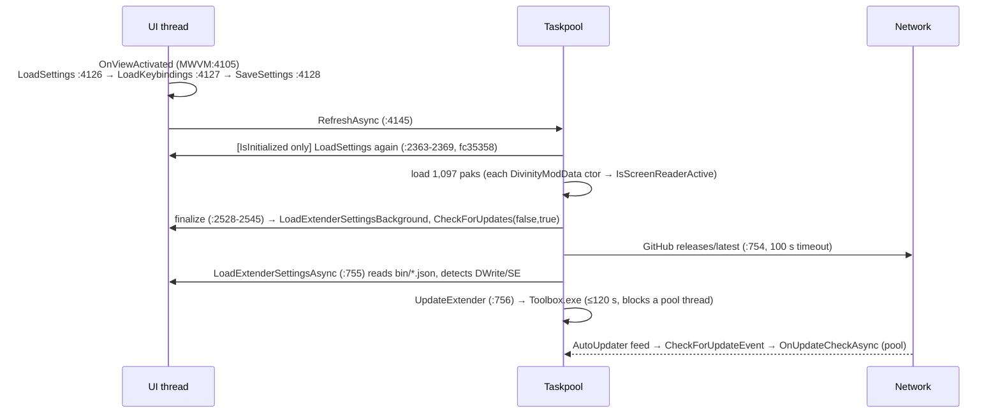

# Settings, persistence, network services, OS integration and security (SVC)

Review of `master` at `fc35358`. The review was read-only. All line numbers refer to that commit. "MWVM" means `src/GUI/ViewModels/MainWindowViewModel.cs`. Script Extender (SE) behaviour was checked against Norbyte/bg3se `main`, fetched on 2026-11-03: `BG3Extender/Extender/Shared/ExtenderConfig.{h,inl}`, `BG3Updater/Config.{h,inl}`, `CoreLib/ConfigUtils.inl` and `README.md`.

Findings that CLAUDE.md, the plan, AUDIT-PLAN, AUDIT-CLAUDE or HARV already describe are left out, unless this review adds something new or corrects them. Those findings name their source in **Known as**.

---

## Map

### Files and responsibilities

| Area | Files | Role |
|---|---|---|
| Settings model | `Core/Models/DivinityModManagerSettings.cs`, `WindowSettings.cs`, `App/ConfirmationSettings.cs`, `App/AppSettings.cs`, `App/DefaultPathwayData.cs`, `App/IgnoredModsData.cs`, `Extensions/ModelExtensions.cs` (`SetToDefault`, two `SetFrom` overloads), `Attributes/*` | `[DataContract]` POCO/ReactiveObject graph serialised with Newtonsoft to `<exe>/Data/settings.json`. `AdditionalFields` (`[JsonExtensionData]`) keeps unknown keys. The only migration is `LaunchThroughSteam` → `LaunchType` (`:171-178`). There is no schema version. |
| Settings I/O | MWVM `LoadSettings` `:1112-1221`, `SaveSettings` `:1245-1269`, `QueueSave` `:1273-1278`, `_managerSerializerSettings` `:1232-1243` (`IgnoreAndPopulate`, Error handler marks every error handled) | Reads with `File.OpenText`. Writes with `File.WriteAllText`, not atomically. Every save also writes `keybindings.json` (`AppKeys.cs:166-198`). |
| Preferences UI | `GUI/Views/SettingsWindow.xaml.cs` (UI generated by reflection, `:101-279`), `GUI/ViewModels/SettingsWindowViewModel.cs` (autosave `:441-446`, SE export `:270-309`, SE manifest `:169-239`) | A 100 ms throttled autosave invokes `SaveSettingsCommand` on a pool thread. The Extender and Updater tabs write JSON into the game's `bin/`. |
| SE files in `bin/` | `Core/Models/Extender/*`, MWVM `WriteInsanityCheck` `:837-857`, `LoadExtenderSettingsAsync` `:702-747`, `UpdateExtender` `:418-472`, `DownloadScriptExtender` `:329-411` | Write `ScriptExtenderSettings.json` and `ScriptExtenderUpdaterConfig.json`, download `DWrite.dll`, run Toolbox. |
| Toolbox | `src/Toolbox/**` | A PowerArgs console app. It calls `LoadLibraryA(DWrite.dll)`, then `SEUpdaterInitialize(binPath)`, `SEUpdate()` and `SEUpdaterShutdown()`. |
| App update | `App.xaml.cs:34-47`, `AppUpdateWindowViewModel.cs`, `AppUpdateWindow.xaml.cs`, `Update.xml` | AutoUpdater.NET 1.9.2 with a custom `CheckForUpdateEvent`. |
| Network | `Core/Util/WebHelper.cs` (one `HttpClient` from Splat, registered at `App.xaml.cs:30-32` with no `Timeout`, so the default is 100 s), `GithubHelper.cs`, `NexusModsDataLoader.cs`, `ModUpdater/**`, `Models/{NexusMods,Steam,Github,Cache,Updates}` | Live endpoints: api.github.com (SE release), raw.githubusercontent (Update.xml, Changelog.md) and bg3se-updates.norbyte.dev (SE manifest). Nexus, Workshop and GitHub mod updates are dead or disabled. |
| OS integration | `ProcessHelper.cs`, `DivinityGlobalCommands.cs:33-109`, `DivinityRegistryHelper.cs`, `JunctionPoint.cs`, `NativeLibraryHelper.cs`, `AppServices/{FileWatcherService,ScreenReaderService,ModRegistryService}.cs`, `app.manifest` | Process launch, registry and VDF game discovery, one FileSystemWatcher, CrossSpeak/Tolk. |

### Main flows

- **Settings load:** `LoadSettings` → `SafeDeserialize` (`DivinityJsonUtils.cs:29-37`) → `Settings.SetFrom<…, ReactiveAttribute>` (only `[Reactive]` properties) plus two untyped `SetFrom` calls for the extender objects (`:1127-1129`) → `LoadAppConfig` (`:4689`) → `SetGamePathways` → on first run, `SaveSettings` (`:1206`).
- **Settings save:** 19 call sites run `SaveSettings` immediately. Window geometry goes through two debounces: 500 ms in `MainWindow.xaml.cs:199-203`, then `QueueSave` at 250 ms. The Preferences autosave runs `Throttle(100 ms)` → `SaveSettingsCommand` on a pool thread → `SettingsWindowViewModel.SaveSettings` → `Main.SaveSettings()`, plus a per-tab SE export (`:339-364`).
- **Game launch:** `Keys.LaunchGame` (`:897-1008`) → `ProcessHelper.TryOpenPath(exe, File.Exists, args, dir)` (ShellExecute), or `steam://run/1086940//<args>` through `TryOpenUrl`, or the custom launch through `TryRunCommand` (ShellExecute of a string from settings). All three inputs are user settings, so they are trusted at the same privilege level as the user.
- **Threading:** no `Dispatcher.Invoke`. The UI thread owns settings mutation, except for the autosave, `UpdateExtender` and `OnUpdateCheckAsync`, which run on the pool and write `[Reactive]` state (SVC-08, SVC-09).

### Answers to the focus questions, where there is no finding

- **ProcessHelper and untrusted URLs.** No live path takes a URL from mod metadata. Nexus links are built from an integer ModId (`DivinityModData.cs:257-261`). The GitHub link path is dead (`GithubData` is null). The only `OpenURLCommand` binding is in the dead Mod Updates view (`ModUpdatesLayout.xaml:192`, `UpdateLink` is always `""`, HARV-42). Changelog Markdown links use `NavigationCommands.GoToPage` (`Markdown.cs:186`), and no `CommandBinding` exists, so they do nothing. The hazard is latent; see SVC-12.
- **FileWatcherService at scale.** There is exactly one watcher (MWVM:5411), on the profile folder, with the filter `*modsettings.lsx`. The Mods folder (1,097 paks) is **not watched**, so event storms and `InternalBufferOverflow` cannot happen. The flip side is that external changes to Mods are never noticed until F5. The watcher has a real bug; see SVC-04.
- **Secrets in logs.** No path logs the Nexus key or the settings JSON. `GithubHelper` dumps release JSON only in `#if DEBUG` (`:36-39`). Paths in alerts are known (AUDIT 5.27).
- **HttpClient.** There is one shared instance (good), with `User-Agent` set. It has no `Timeout`, so the default 100 s applies. `PooledConnectionLifetime` is not set (Info). `WebHelper.Download*` swallow everything, including cancellation (known, HARV-49).
- **Registry.** Only the HKLM Steam `InstallPath` (64-bit and WOW6432 keys) and the GOG `path` are read. The `RegistryKey` handles are never disposed (`DivinityRegistryHelper.cs:39`, Info). There is no `HKCU\Software\Valve\Steam\SteamPath` fallback, so a Steam install without the HKLM value falls through to GOG, then to manual setup (Info). On Linux, `Registry.LocalMachine` throws `PlatformNotSupportedException`. The throw comes from `GetSteamInstallPath` at `:82`, outside `GetKey`'s try, but `GetGameInstallPath`'s outer try catches it.
- **app.manifest.** No `requestedExecutionLevel`, so the app runs asInvoker (fine). `longPathAware` is true. There is no DPI-awareness element (see "Needs a Windows run"). Toolbox has no manifest of its own.
- **Recent upstream settings fixes.** `4ee4455` and `2d62b17` are complete for what they target. `fc35358` is correct in itself, but every manual F5 now re-reads `settings.json` and re-runs `LoadAppConfig` (`:2367`), which also resets transient extender state; see SVC-07. **`7b57e5a` introduced the Window/Confirmations regression (SVC-02).** **`d234c25` never works (SVC-13).**

---

## Findings

### [High] SVC-01: Compressed single-file import names its output from meta.lsx `Folder` without sanitising it (path traversal)
- **Location:** MWVM:3296-3302 (`ImportCompressedFileAsync`). `Folder` is taken verbatim from meta.lsx at `Core/Util/DivinityModDataLoader.cs:229`.
- **What:** For `.bz2`, `.xz` and `.zst` imports, when the archive name does not contain `mod.Name`, the output path becomes `Path.Combine(Mods, $"{mod.Folder}.pak")`. `Folder` comes from the untrusted pak's meta.lsx. A value with `..\` segments or a rooted path escapes the Mods folder. `File.Create` then truncates or creates that file. The other two import paths use `Path.GetFileName` (`:1840`, `:3424`) and are safe.
- **Failure scenario:** The user drops `CoolMod.pak.zst` downloaded from a mod site. Its meta.lsx has `Name="X"` and `Folder="..\..\..\..\..\Program Files (x86)\Steam\steamapps\common\Baldurs Gate 3\Data\Gustav"`. The write lands on the game's `Data\Gustav.pak`. Today it writes 0 bytes (AUDIT-PLAN-02), which destroys the base pak. Once AUDIT-PLAN-02 is fixed, the write carries attacker-chosen content to any writable `*.pak` path.
- **Evidence:** `var nameFromMeta = $"{mod.Folder}.pak"; outputFilePath = Path.Combine(outputDirectory, nameFromMeta); … File.Create(outputFilePath, …)`. `Path.Combine` returns the second argument unchanged when it is rooted.
- **Fix:** `var safe = DivinityModDataLoader.MakeSafeFilename(Path.GetFileName(mod.Folder), '_');` reject an empty result, then assert `Path.GetFullPath(out).StartsWith(Path.GetFullPath(Mods) + Path.DirectorySeparatorChar)`. Put the same guard in a shared `SafeModsPath()` helper used by all import paths and by the LIB design.
- **Confidence:** Confirmed in source. Whether a standard user can write to the Steam library folder needs a Windows check; Steam usually grants Users write access.
- **Known as:** new. Related to AUDIT-PLAN-02 (0-byte write) and HARV-61 (in-place truncation).

### [Medium] SVC-02: `Settings.Window` and `Settings.Confirmations` are never restored, a regression from `7b57e5a`; the restore code is also wrong for negative coordinates
- **Location:** MWVM:1127; `DivinityModManagerSettings.cs:112,122`; `MainWindow.xaml.cs:205-238`
- **What:** This confirms AUDIT-CLAUDE Gap 1. Before `7b57e5a`, `Settings.SetFrom(settings)` (untyped, `TypeDescriptor`) copied both objects by reference. `7b57e5a` switched to `SetFrom<…, ReactiveAttribute>`. Neither property has `[Reactive]`, and there is no separate restore for them, unlike the extender objects at `:1128-1129`. Both are still saved. Separately, `ApplyWindowPosition` treats any negative X or Y as "unset" (`:231-232`), so the fix alone would still lose positions on a monitor left of or above the primary.
- **Failure scenario:** (1) "Save Window Location" is on. The window opens with default geometry every launch, although `settings.json` holds the real values. (2) An admin user clicks Cancel on the elevation warning (MWVM:4158-4161). The warning comes back at every start. (3) After the fix, a window saved at X = -1700 on a left-hand monitor opens on the primary.
- **Evidence:** `git show 7b57e5a`: `-Settings.SetFrom(settings);` `+Settings.SetFrom<DivinityModManagerSettings, ReactiveAttribute>(settings);`. `[DataMember] public WindowSettings Window`. `[DataMember] public ConfirmationSettings Confirmations`. `if (winX < 0) winX = Left;`.
- **Fix:** After `:1129`, add `if (settings.Window != null) Settings.Window = settings.Window;`. `MainWindow` re-reads `ViewModel.Settings.Window` every time (`:179`), so swapping the instance is safe. Add `if (settings.Confirmations != null) Settings.Confirmations.SetFrom(settings.Confirmations);`. In `ApplyWindowPosition`, use `double.NaN` or `Width > 0` as the "unset" sentinel instead of -1, and clamp the saved rectangle to `Screen.AllScreens` working areas so a window cannot land off-screen. Use an upstreamable `fix/settings-restore-window` branch.
- **Confidence:** Confirmed (static, with the git history).
- **Known as:** AUDIT-CLAUDE Gap 1. New here: the cause commit, the negative-coordinate bug and the off-screen clamp.

### [Medium] SVC-03: An empty or corrupt `settings.json` or `keybindings.json` is silently replaced with defaults at startup, and every settings write is non-atomic
- **Location:** MWVM:1118-1136, 1161-1207, 1256, 4126-4128; `AppKeys.cs:183-188, 205-218`; `SettingsWindowViewModel.cs:278, 298`; `IExternalModCacheDataExtensions.cs:63-65`
- **What:** `File.WriteAllText` truncates first and then writes. A crash, power cut or BSOD mid-write leaves a 0-byte or NUL-filled file. On the next start, `SafeDeserialize` returns null: an empty string gives null, and a root-level parse error is marked handled and also gives null. `loaded` is then false. No alert is shown, because only exceptions alert and none are thrown. The "first run" branch runs and calls `SaveSettings()`, which overwrites the file with defaults, and `OnViewActivated` saves again at `:4128`. `LoadKeybindings` fails silently in the same way, and the next `SaveSettings` writes `{}` over the user's bindings. No `.bak` copy is kept.
- **Failure scenario:** The game or GPU driver crashes the PC while the manager saves after a window move. With "Save Window Location" on, every 500 ms resting pause triggers a write of both files. On the next start, `DocumentsFolderPathOverride`, `LastOrder`, launch settings, `CheckForUpdates=false` and custom hotkeys are gone with no message. The override matters most: the manager then reads profiles and mods from the default AppData path.
- **Evidence:** `File.WriteAllText(settingsFile, contents);`, `if (settings != null) { loaded = true; … }` with no else alert, and `else { … SaveSettings(); }`. The same `WriteAllText` pattern is used for `ScriptExtenderSettings.json`, `ScriptExtenderUpdaterConfig.json` and the cache files.
- **Fix:** Add one `AtomicFile.WriteAllText(path, text)` helper: write `path.tmp` in the same folder, `Flush(true)`, then `File.Replace(tmp, path, path + ".bak")`, or `File.Move(tmp, path, true)` when the file is new. On load, if the file exists but deserialises to null or is shorter than 2 bytes, try `.bak`. If that also fails, rename the bad file to `settings.corrupt-<ts>.json`, `ShowAlert(Warning)`, and do **not** save until the user changes something. Apply the same to keybindings. Upstreamable.
- **Confidence:** Confirmed (control flow). The NUL-fill after power loss is standard NTFS behaviour, not reproduced here.
- **Known as:** new. HARV-62 covers order JSON and HARV-67 covers two instances; this finding is about the settings and keybindings files and the silent reset.

### [Medium] SVC-04: The modsettings.lsx reset watcher is permanently disabled after the first Save of the "Current" order
- **Location:** `Core/AppServices/FileWatcherService.cs:66-77`; MWVM:2624-2630, 5420-5445
- **What:** `PauseWatcher(true, 1000)` sets `EnableRaisingEvents = false`, then schedules a timer that sets it to `false` again instead of `true`. Nothing else turns it back on. `IsEnabled` only re-binds on a distinct change, and switching profiles keeps it `true`. The pause also comes after `await ExportLoadOrderAsync()` has already written the file, so it does not suppress the self-triggered event either.
- **Failure scenario:** The user presses Save (Ctrl+S) with "Current" selected, then launches BG3. The game rejects a mod and resets modsettings.lsx, which is common after a patch. The "active load order has been reset externally" alert and the taskbar flash (MWVM:5433-5441) never fire for the rest of the session. The user exports again, or keeps playing, on an emptied order without warning.
- **Evidence:** `_pauseToggleTask = RxApp.TaskpoolScheduler.Schedule(TimeSpan.FromMilliseconds(pauseFor), () => { _watcher.EnableRaisingEvents = false; });`. `PauseWatcher` has exactly one caller (MWVM:2629).
- **Fix:** Set `true` in the timer. Call `PauseWatcher(true, 1000)` **before** `ExportLoadOrderAsync()`. Also subscribe `_watcher.Error` and log it. Upstreamable `fix/modsettings-watcher-resume`.
- **Confidence:** Confirmed.
- **Known as:** new. HARV-60 covers partial drops, a different detector gap.

### [Medium] SVC-05: The manager's Script Extender settings model no longer matches what the extender reads
- **Location:** `Core/Models/Extender/ScriptExtenderSettings.cs:38-41, 113-116, 128-131`; export at `SettingsWindowViewModel.cs:276-278` and MWVM:844-851
- **What:** Only non-default values are written, so a key is omitted whenever the manager's `[DefaultValue]` equals the user's choice. Two manager defaults differ from SE's defaults (`ExtenderConfig.h`): `LogFailedCompile` is false in the manager and true in SE, and `ClearOnReset` is false in the manager and true in SE. Unticking either box writes nothing, so SE keeps true. The manager writes `DebuggerFlags`, but SE reads `DebugFlags` (`ExtenderConfig.inl`), so that setting never applies. `ShowPerfWarnings` and `DisableStoryMerge` are not read by SE at all; perf messages are `EnablePerfMessages` and default to `CreateConsole`. `EnableExtensions`, `DisableModValidation` and `DumpNetworkStrings` appear only in SE's README, not in `ApplyConfig`. Yet `EnableExtensions=false` makes the manager flag every Lua mod "DisabledFromConfig" (MWVM:2179-2181).
- **Failure scenario:** A user unticks "Log Working Story Errors" to stop log spam. The saved file omits the key and SE keeps logging. A user hand-sets `"LogFailedCompile": false` in the game file. The manager loads it, and on its next write (`WriteInsanityCheck` on a refresh, or any Extender-tab autosave) it drops the key, which silently reverts the setting.
- **Evidence:** Manager: `[DefaultValue(false)] … LogFailedCompile`, `[DefaultValue(false)] … ClearOnReset`, `public int DebuggerFlags`. SE: `bool LogFailedCompile{ true };`, `bool ClearOnReset{ true };`, `ConfigGet(root, "DebugFlags", config.DebugFlags);`. The SE README table lists LogFailedCompile with default `true`.
- **Fix:** Set `[DefaultValue(true)]` on `LogFailedCompile` and `ClearOnReset`. Rename the JSON key with `[JsonProperty("DebugFlags")]` and keep reading the old name. Remove the four or five dead toggles, or hide them behind a "legacy" flag. Add `EnablePerfMessages`, `LuaDebuggerPort` and `DisableStoryCompilation`. Better still, always write the keys the user changed, using a "touched" set, rather than relying on default comparison. Upstreamable.
- **Confidence:** Confirmed for the default mismatches and the key name, against SE `main` source. Plausible for "not read" of `EnableExtensions` and `DisableModValidation`: GitHub code search finds them only in the README, and an older SE build could still read them.
- **Known as:** CLAUDE.md section 7. This extends it: the general "defaults are omitted" note hides these concrete mismatches.

### [Medium] SVC-06: Every manager write of the SE config files drops keys the manager doesn't model
- **Location:** `ScriptExtenderSettings.cs` and `ScriptExtenderUpdateConfig.cs` (no `[JsonExtensionData]`); writes at `SettingsWindowViewModel.cs:277-278, 297-298` and MWVM:850-851; reads at MWVM:711-731
- **What:** The manager deserialises `bin/ScriptExtenderSettings.json` into a fixed type, and later serialises that type back over the file, so unknown keys are lost. Keys SE reads that the manager does not model: `DisableStoryCompilation`, `EnablePerfMessages`, `LuaDebuggerPort`, `ExtendStory`, `ForceCrashReporting`, `LocalMessagePassing`, `Optick`, `MergeVirtualTextures` and four `Profiler*Threshold` keys. For the updater config: `DebugLoadSE`. `DivinityModManagerSettings` already solves this for its own file with `AdditionalFields` (`:168-169`).
- **Failure scenario:** A mod author follows SE docs and sets `"EnablePerfMessages": false` and `"LuaDebuggerPort": 9997` in the game's file. The manager rewrites the file whenever `WriteInsanityCheck` runs. That happens on the first F5 after `DeleteModCrashSanityCheck` (default true) sees `InsanityCheck` false (MWVM:1098-1108, 1214-1218). It also happens on any autosave while the Extender tab is open. Both keys vanish without a message.
- **Evidence:** `JsonConvert.SerializeObject(Settings.ExtenderSettings, …); File.WriteAllText(outputFile, contents);`. Neither SE model has an extension-data member.
- **Fix:** Add `[JsonExtensionData] private IDictionary<string, JToken> _extra = new Dictionary<string, JToken>();` to both SE models. Let `SetFrom` carry it, or better, read-modify-write: load the current file as a `JObject`, overlay only the manager's keys, and write it atomically (SVC-03). Upstreamable.
- **Confidence:** Confirmed.
- **Known as:** new.

### [Medium] SVC-07: "Export Default Values" is never persisted and resets on every refresh; when on, it breaks the SE updater config
- **Location:** `ScriptExtenderSettings.cs:17-21` (`[JsonIgnore]`); MWVM:1128, 714 (untyped `SetFrom`); `SettingsWindowViewModel.cs:296-298`
- **What:** (a) `[JsonIgnore]` excludes the property from `settings.json` and from the `bin/` file. On every load, the deserialised `ScriptExtenderSettings` carries the default `false`, and the untyped `SetFrom` copies every non-null value. A `bool` is never null, so the user's `true` is overwritten. This happens in `LoadSettings` on every F5 since `fc35358`, and again in `LoadExtenderSettingsAsync` after every refresh. The same path also resets the transient `ExtenderIsAvailable`, `ExtenderVersion` and `ExtenderMajorVersion` to defaults until the background re-detection finishes. (b) While the toggle is on, saving the Updater tab writes `"ManifestURL": ""`, `"ManifestName": ""` and `"CachePath": ""`. SE's `LoadConfigFile` sets the built-in values first, and `ConfigGet` then overwrites them with these empty strings (`BG3Updater/Config.inl`).
- **Failure scenario:** (a) A user enables the workaround from CLAUDE.md §7 to keep defaults in the file. After the next F5 it is off again, and later saves go back to omitting keys. (b) A modder with Developer Mode on (that is what shows the Updater tab) ticks Export Default Values and saves the Updater tab. The SE updater then fetches from an empty URL. On a machine with no cached SE, the extender never installs, and every SE mod fails.
- **Evidence:** `[JsonIgnore] … public bool ExportDefaultExtenderSettings`. `SetFrom<T>`: `if (value != null) pr.SetValue(target, value)`. SE: `config.ManifestURL = UPDATER_MANIFEST_URL; … ConfigGet(root, "ManifestURL", config.ManifestURL);`, where `ConfigGet` accepts any string, including an empty one.
- **Fix:** Move the toggle to `DivinityModManagerSettings` as a normal `[DataMember, Reactive]` setting. In the updater export, always use `NullValueHandling.Ignore` and convert empty strings to null, for example with `[DefaultValue(null)]` on `ManifestURL`, `ManifestName` and `CachePath`, so empty values are never written. Upstreamable.
- **Confidence:** Confirmed (source plus SE source).
- **Known as:** new.

### [Medium] SVC-08: Saving on the SE Updater tab runs Toolbox synchronously on the UI thread, and autosave runs it on every change
- **Location:** `SettingsWindowViewModel.cs:300` → MWVM:418-458 (`process.WaitForExit(120000)`); `SettingsWindowViewModel.cs:440-446`; `SettingsWindow.xaml.cs:359, 410`
- **What:** `SaveSettingsCommand` is a plain `ReactiveCommand.Create`. Clicking the button or pressing Ctrl+S runs it synchronously on the UI thread. On the Updater tab it calls `ExportExtenderUpdaterSettings` and then `Main.UpdateExtender(true)`. That starts Toolbox.exe, which runs the SE updater (manifest fetch and possibly a package download), and blocks for up to 120 s. The 100 ms throttled autosave does the same for every watched property change on that tab, on a pool thread. Rx `Throttle` forwards `OnNext` while holding its gate, so a UI-thread property change made while that pool-thread save is running probably blocks too. Toolbox runs are not serialised against the post-refresh `UpdateExtender` (MWVM:756) or the post-download one (`:404`).
- **Failure scenario:** A modder changes Update Channel, then types a Target Version. Each pause longer than 100 ms starts a Toolbox run. Pressing Save freezes the window ("Not responding") until the SE updater finishes, which can be tens of seconds on a slow link and up to 120 s when blocked. Two SE updaters can run at once against `%LOCALAPPDATA%\BG3ScriptExtender`.
- **Evidence:** `SaveSettingsCommand = ReactiveCommand.Create(SaveSettings, whenVisible);` (no scheduler). `case SettingsWindowTab.ExtenderUpdater: ExportExtenderUpdaterSettings();`, which calls `Main.UpdateExtender(true);`, which calls `if (!process.WaitForExit(120000)) process.Kill();`.
- **Fix:** Make `UpdateExtender` async (`await process.WaitForExitAsync(ct)`) behind a `SemaphoreSlim(1)`. Coalesce requests: one pending run, and drop extra triggers. Never run it from the autosave path; save the JSON only, and run Toolbox on explicit Save or on game launch. Use `ReactiveCommand.CreateFromTask` for Save. Upstreamable.
- **Confidence:** Confirmed for the synchronous UI-thread call. Plausible for the Throttle gate blocking the UI thread; a Windows run would confirm it.
- **Known as:** new.

### [Medium] SVC-09: The update window binds to view-model properties that are set on a pool thread; after the window has been shown once, the next check probably throws a cross-thread exception
- **Location:** `AppUpdateWindowViewModel.cs:70-87` (runs on `RxApp.TaskpoolScheduler`, `:118`); `AppUpdateWindow.xaml.cs:44-52`; `App.xaml.cs:39-45`
- **What:** `OnUpdateCheckAsync` marshals only `UpdateChangelogView` and `IsVisible`. `UpdateDescription`, `CanConfirm`, `SkipButtonText`, `CanSkip` and `UpdateVersion` are set on the pool. ReactiveUI `OneWayBind` and `BindCommand` set the target (`TextBlock.Text`, `Button.Content`, `IsEnabled`) on the thread that raised `PropertyChanged`. The bindings exist only after `WhenActivated` (Loaded). `Hide()` keeps them alive, so the first ever check is fine and later checks are not.
- **Failure scenario:** The user presses F7, sees "is up-to-date" and closes the window, which only hides it. Pressing F7 again makes the setter throw `InvalidOperationException` ("calling thread cannot access this object"). The exception goes through ReactiveObject `ThrownExceptions`, then `RxApp.DefaultExceptionHandler`: a raw error MessageBox in Release (`RxExceptionHandler.cs:16`), and the dispatcher handler in Debug. The window is not refreshed.
- **Evidence:** `UpdateDescription = $"{AppTitle} {args.CurrentVersion} is now available…";` inside a `CreateFromTask(…, RxApp.TaskpoolScheduler)` body, next to `await Observable.Start(() => { UpdateChangelogView = markdownText; }, RxApp.MainThreadScheduler);`.
- **Fix:** Wrap the whole branch (`:68-95`) in one `await Observable.Start(…, RxApp.MainThreadScheduler)`, or `ObserveOn(RxApp.MainThreadScheduler)` before `InvokeCommand`. Fold this into S1's `fix/update-check-errors`.
- **Confidence:** Plausible. The pool-thread writes are confirmed. That ReactiveUI 20 `OneWayBind` does not marshal is from its source design (`BindToDirect` subscribes without a scheduler); a Windows run pressing F7 twice would confirm it.
- **Known as:** new. It lands on the same lines as HARV-02 (S1 F9), but it is a different defect.

### [Low] SVC-10: Extender status and SE settings wait for the GitHub API; with no HttpClient timeout, a black-holed network shows every SE mod as "missing" for up to 100 s, and the API is called unauthenticated on every refresh
- **Location:** MWVM:749-758 (sequential `await CheckForLatestExtenderUpdaterRelease` → `LoadExtenderSettingsAsync`); `App.xaml.cs:30-32`; `GithubHelper.cs:12-17`
- **What:** The local, fast step (reading `bin/*.json` and detecting `DWrite.dll` and `BG3ScriptExtender.dll`) runs only after the GitHub request completes. Until then, `ExtenderMajorVersion` is -1 and `UpdaterIsAvailable` is false (neither is persisted). So `UpdateModExtenderStatus` marks Lua mods `MissingRequiredVersion | MissingUpdater`, and the download button blinks (MWVM:2185-2216). The request runs after every refresh (F5), with no ETag or cache. GitHub allows 60 unauthenticated requests per hour per IP.
- **Failure scenario:** Behind a captive portal or a firewall that drops packets, the request takes 21 s (Windows TCP connect) to 100 s (`HttpClient` default). For that whole time the owner's SE mods show extender warnings. CGNAT or shared IPs hit 403 sooner, which flips `OpenRepoLinkToDownload`.
- **Evidence:** `await CheckForLatestExtenderUpdaterRelease(t); await LoadExtenderSettingsAsync(t);`. `var client = new HttpClient();` with no `Timeout` set.
- **Fix:** Run `LoadExtenderSettingsAsync` first, then the GitHub check, fire-and-forget. Cache the release URL and tag in settings with a 12 h TTL. Set `client.Timeout = TimeSpan.FromSeconds(15)`, with per-call CTS overrides for downloads.
- **Confidence:** Confirmed (ordering and timeout). Timings are standard platform behaviour.
- **Known as:** new.

### [Low] SVC-11: The downloaded `DWrite.dll` is executed immediately by Toolbox, with no publisher or hash check
- **Location:** MWVM:351-366, 401-405; `Toolbox/ScriptExtender/Updater.cs:147`; MWVM:522-523
- **What:** After the download, the manager calls `UpdateExtender(true)`, and Toolbox `LoadLibraryA`s the new DLL. Its `DllMain` and `SEUpdaterInitialize` run at once, without waiting for the user to start the game. The only check before that is `FileVersionInfo.ProductName` containing "Script Extender", which anyone can set. The asset is "the first `.zip` in Norbyte/bg3se releases/latest whose URL does not contain `Console`" (`:655-668`). Trust rests entirely on TLS and the GitHub account.
- **Failure scenario:** A compromised release, or a hostile asset uploaded to that release, runs native code in Toolbox the moment the user clicks "Download & Install", at the user's privilege level. If the manager runs elevated, which it warns about, the code runs elevated.
- **Evidence:** `File.Create(dllDestination…)` then `await Observable.Start(() => UpdateExtender(true), RxApp.TaskpoolScheduler);` then `LoadLibrary(_updaterPath)`.
- **Fix:** Verify Authenticode with `WinVerifyTrust` and pin the publisher, if Norbyte signs DWrite.dll (see "Needs a Windows run"). Otherwise pin the SHA-256 of known releases in a fork-maintained manifest. Do not run Toolbox until the next explicit user action. Combine with HARV-47's temp-and-rename.
- **Confidence:** Confirmed (code path). Whether the DLL is signed is unknown.
- **Known as:** HARV-47 / S9 B12 (adds the immediate-execution and spoofable-check angles).

### [Low] SVC-12: `ProcessHelper.TryOpenUrl` first runs the string as a program, then ShellExecutes it, and its `&` escaping corrupts URLs
- **Location:** `Core/Util/ProcessHelper.cs:88-117`
- **What:** `Process.Start(url, args)` with `UseShellExecute=false` (the .NET default) tries to execute `url` as a file. A bare name such as `calc` or `cmd` resolves through the search path and runs. Only after that fails does it ShellExecute, which runs any protocol handler or local file. The fallback replaces `&` with `^&`, an escape that only `cmd.exe` understands, so a URL with a query string (`?a=1&b=2`) reaches the browser mangled.
- **Failure scenario:** It is latent today; no untrusted URL reaches it (see Map). With Stage 9 (Nexus or mod.io pages, dependency links from mod metadata), a crafted link string such as `C:\Users\Public\x.exe`, `file://…` or `search-ms:` would launch directly.
- **Evidence:** `Process.Start(url, args);` and `url = url.Replace("&", "^&");`.
- **Fix:** `if (!Uri.TryCreate(url, UriKind.Absolute, out var u) || (u.Scheme != Uri.UriSchemeHttps && u.Scheme != Uri.UriSchemeHttp && u.Scheme != "steam")) return;` then `Process.Start(new ProcessStartInfo(u.AbsoluteUri) { UseShellExecute = true })`. Drop the `^&` hack.
- **Confidence:** Confirmed (latent).
- **Known as:** new.

### [Low] SVC-13: `d234c25` ("Load extender settings on first settings load") never works
- **Location:** MWVM:1178, 1194, 1202
- **What:** `DivinityJsonUtils.SafeDeserialize<T>(string text, …)` is passed the file **path** as JSON text. The handled-error settings turn the parse failure into `null`, so the first-run import is always skipped. The second log line also prints `extenderConfigPath` for the updater file. After the first refresh, `LoadExtenderSettingsAsync` reads the files properly, so the user-visible effect is small. The settings saved on first run hold defaults rather than the game's values.
- **Evidence:** `DivinityJsonUtils.SafeDeserialize<ScriptExtenderSettings>(extenderConfigPath)` (introduced in `d234c25`).
- **Fix:** Call `SafeDeserializeFromPath<…>(path)` and log the right variable. Upstreamable one-liner.
- **Confidence:** Confirmed.
- **Known as:** new.

### [Low] SVC-14: Toolbox and ScreenReaderService load DLLs with `LoadLibraryA` and pass paths as `LPStr`
- **Location:** `Toolbox/NativeMethods.cs:7-8`; `Toolbox/ScriptExtender/Updater.cs:73-74`; `Core/Util/NativeLibraryHelper.cs:5-6`; `ScreenReaderService.cs:61`
- **What:** ANSI entry points convert the path through the system code page. A game or app path with characters outside that code page fails to load, or reaches SE mangled. For example, Cyrillic or CJK folder names on an en-US Windows, or such a name in the user profile when the app sits under `%USERPROFILE%`. The only trace is a `[Toolbox]` log line, and logging is off by default.
- **Failure scenario:** The Steam library is at `D:\Игры\SteamLibrary` on an English-locale PC. `LoadLibraryA` returns 0, the updater does nothing, and SE never updates from the manager.
- **Evidence:** `[LibraryImport("kernel32.dll", EntryPoint = "LoadLibraryA")] … [MarshalAs(UnmanagedType.LPStr)] string lpFileName`.
- **Fix:** Use `NativeLibrary.TryLoad(path, out h)` (wide-char) and `NativeLibrary.GetExport`. Keep `LPStr` only where SE's export really expects ANSI, and in that case pass a short 8.3 path or check that `Encoding.Default` round-trips.
- **Confidence:** Confirmed (source). Impact needs a Windows run on a non-ANSI path.
- **Known as:** new.

### [Low] SVC-15: The screen-reader probe runs concurrently from about 1,100 loader tasks against unsynchronised Tolk/CrossSpeak state
- **Location:** `DivinityModData.cs:520-524` (the constructor's `WhenAnyValue` emits synchronously on the constructing thread); `DivinityModDataLoader.cs:777-784` (`Task.WhenAll` over every pak); `ScreenReaderService.cs:22, 49-79`; `External/CrossSpeak/CrossSpeak/ScreenReaderWindows.cs:23-33`
- **What:** This adds to HARV-73, which is about cost. Every `DivinityModData` constructor calls `IsScreenReaderActive()` on whichever pool thread is loading that pak. With no reader running, each call runs `Tolk.Load()` and `Tolk.DetectScreenReader()`. The calls overlap across threads with no lock. The static `_loadedDlls` flag and CrossSpeak's `isLoaded` are plain fields.
- **Failure scenario:** Rare native races in Tolk's global driver list during the 9 s load. The likely symptoms are an access violation (a process crash, not catchable) or a wrong detection result.
- **Evidence:** `.Select(x => !DivinityApp.IsScreenReaderActive() && …)` inside the constructor; `private static bool _loadedDlls`.
- **Fix:** HARV-73's memoisation fixes both: compute once on the UI thread at startup, cache it in a `volatile bool`, refresh it on a 5 s timer, and have the constructor read the cache.
- **Confidence:** Plausible. Whether Tolk is thread-safe is not documented here, and this needs a Windows stress run.
- **Known as:** HARV-73 (adds the concurrency angle).

### [Low] SVC-16: Blockers for reviving Nexus that S9's B-list misses: an NRE on a missing cache file, no freshness gate, and Clear Cache short-circuiting
- **Location:** `Core/ModUpdater/ModUpdateHandler.cs:56-72, 143-146`; `IExternalModCacheDataExtensions.cs:26-44`
- **What:** (a) `LoadCacheAsync` returns `default` (null) when `nexusmodsdata.json` does not exist, and `LoadAsync` then runs `foreach (var entry in data.Mods)`, which throws an NRE on the very first run with Nexus enabled. (b) Nexus has no `LastUpdated` gate; Workshop has one at `:51`. So `UpdateAsync` makes one `GetMod` call per Nexus-ID'd mod on **every** run. (c) `DeleteCache()` uses `||`, so the live "Clear cache" button (`SettingsWindowViewModel.cs:483-505`) deletes only the first cache file that exists.
- **Failure scenario:** Stage 9 turns the flag on. The first refresh crashes the background task. After the NRE is fixed, an owner with about 900 Nexus-linked mods spends 900 calls per refresh against Nexus's 2,500 per day, so the third F5 of the day exhausts the key.
- **Evidence:** `var data = await Nexus.LoadCacheAsync(currentAppVersion, cts); foreach (var entry in data.Mods)`; `return Nexus.DeleteCache() || Workshop.DeleteCache() || Github.DeleteCache();`.
- **Fix:** `if (data != null)`. Gate on `CacheData.LastUpdated` plus per-mod `UpdatedTimestamp` (Nexus `updated` endpoints: one call returns all mods changed in the last day, week or month). Use `|` or separate statements for the delete.
- **Confidence:** Confirmed (latent behind `AppFeatures.NexusModsEnabled=false`, except (c), which is live).
- **Known as:** new. Adds to S9 B1-B12 and HARV-36 to HARV-45.

### [Low] SVC-17: With no game path, SE settings are written to the working directory and reported as saved
- **Location:** `SettingsWindowViewModel.cs:272-280, 292-298`; MWVM:840-851
- **What:** `Path.GetDirectoryName("")` returns null on .NET 8, and `Path.Join(null, "ScriptExtenderSettings.json")` gives a relative path. `File.WriteAllText` then writes into the current directory, and the alert reports success.
- **Failure scenario:** A first-run user without a detected game, for example a non-Steam or non-GOG install, toggles an SE option. The file lands next to the shortcut's "Start in" folder, not in `bin/`, and SE ignores it.
- **Fix:** Check `File.Exists(GameExecutablePath)` first, and show a Warning instead of writing.
- **Confidence:** Confirmed.
- **Known as:** new.

### [Info] SVC-18: Correction to HARV-64: `JunctionPoint` is dead code today
- **Location:** `Core/Util/DivinityRegistryHelper.cs:52-78`; `Core/Util/JunctionPoint.cs`
- **What:** HARV-64 says the junction code "is used when resolving Steam library junctions (DivinityRegistryHelper.cs:59-61)". `GetTruePath`, the only caller of `JunctionPoint`, has **zero callers** in `src/`. The bug is therefore unreachable today and matters only for the LIB junction design. Also, `InternalGetTarget` resolves only `IO_REPARSE_TAG_MOUNT_POINT`. A `mklink /D` symlink returns null, so if `GetTruePath` were ever wired up it would not see symlinked libraries. Since .NET 6, `Directory.ResolveLinkTarget(path, true)` covers both cases.
- **Evidence:** `grep -rn 'GetTruePath\|JunctionPoint\.' src` matches only the definition and its own body.
- **Fix:** Delete `GetTruePath`, or switch it to `ResolveLinkTarget`. Keep `JunctionPoint.Create/Delete` only if LIB-B's junction swap is built.
- **Confidence:** Confirmed.
- **Known as:** HARV-64 (correction).

### [Info] SVC-19: Update-check cadence: the 12 h gate is dead on the automatic path, the changelog is fetched before the result is known, and the SE manifest gate is bypassed
- **Location:** MWVM:2541-2545, 4085-4103; `AppUpdateWindowViewModel.cs:58`; `SettingsWindowViewModel.cs:224, 241-246`
- **What:** The only automatic call passes `skipTimeCheck: true`, so `LastUpdateCheck` never throttles anything. Nothing saves it on that path either, and the next F5 re-reads `settings.json` and overwrites it. `OnUpdateCheckAsync` downloads the 24 KB wiki changelog before it looks at `IsUpdateAvailable` or `Error`. Opening Preferences calls `StartExtenderManifestCheck` directly, which bypasses `CanCheckManifest` (3,000 s). None of this delays startup, because all of it runs after the refresh, on the pool. It is wasted traffic and dead code that S1 can simplify.
- **Fix:** Fetch the changelog only when an update is available. Drop `LastUpdateCheck`, or make it real (12 h, saved). Route the window-shown path through `FetchLatestManifestData`.
- **Confidence:** Confirmed.
- **Known as:** S1 F12 states that the check runs once per launch, which is correct. This adds the dead gate.

---

## Opportunities aligned with the owner's intentions

- **One `AtomicFile` helper, upstreamable first.** SVC-03, HARV-47, HARV-61 and HARV-62 all need the same temp, flush, `File.Replace`/`File.Move` primitive, plus `.bak` recovery. Ship it once as `fix/atomic-writes` from master. The LIB design and Stage 8 reuse it.
- **A settings-restore test seam.** SVC-02, SVC-07 and SVC-13 all come from `SetFrom` semantics. A tiny `SettingsSerializer` (load → restore → save) with a round-trip unit test needs no WPF: serialise a non-default object, load it, and assert every `[DataMember]` survives. It would have caught `7b57e5a`'s regression, and it is cheap to upstream.
- **SE config as read-modify-write over `JObject`** (SVC-05 and SVC-06). This keeps the manager forward-compatible with SE releases without chasing new keys, and is toolkit-neutral (Core only). That matters for "Linux kept open".
- **Serialise Toolbox runs behind one async gate** (SVC-08), and run the SE update on game launch rather than on every settings change. That also removes a 120 s pool-thread block from every refresh at 935 active mods.
- **Stage 1 (fork identity):** when repointing `URL_UPDATE`, also set `HttpClient.Timeout` (SVC-10), fix SVC-09 together with HARV-01 and HARV-02, and give the fork a User-Agent that names the fork. GitHub asks for an identifying UA, and the fork's API traffic should not be counted as upstream's.
- **Stage 9 (Nexus/mod.io):** before reviving anything, add SVC-16 to the B-list, route every remote link through a hardened `TryOpenUrl` (SVC-12), and keep `SafeModsPath()` (SVC-01) as the single place where downloaded content gets a file name.
- **Upstream `avalonia` already has a single-instance check** (`wt-avalonia/src/GUI/Desktop-Avalonia/Program.cs:17-46`, process-name count plus a named pipe for args) and a 20 s download timeout (`DownloadManagerService.cs:64`). Both are ideas worth porting to WPF master; they are not cherry-pickable.

## Needs a Windows run to settle

1. **SVC-09:** press F7, close the window, press F7 again, and check for a cross-thread exception or error box.
2. **SVC-08:** with Developer Mode on, change Update Channel on the Updater tab and click Save. Time the UI freeze (ETW or a stopwatch) and look for overlapping `Toolbox.exe` processes in Task Manager.
3. **SVC-01:** confirm that a standard user can write to `…\Steam\steamapps\common\Baldurs Gate 3\Data`. Use a test pak.zst whose `Folder` traverses into a scratch folder, not the real game.
4. **SVC-03:** truncate `Data/settings.json` to 0 bytes, start the app, and confirm the silent reset and the overwrite.
5. **SVC-05:** untick "Log Working Story Errors", save, launch with SE, and check that `LogFailedCompile` still behaves as true. Run `ConfigGet` checks against the user's installed SE version, not just `main`.
6. **SVC-11:** run `Get-AuthenticodeSignature "<bg3>\bin\DWrite.dll"`. If it is signed, pin the publisher.
7. **SVC-14:** put the game under a folder whose name is outside the code page (or use `subst` to map one) and run Toolbox.
8. **SVC-15 / HARV-73:** time `IsScreenReaderActive()` with and without NVDA running, and run 1,100 concurrent calls under a stress harness.
9. **app.manifest DPI:** check whether the main window is blurry on a mixed-DPI multi-monitor setup. If it is, add `<dpiAwareness>PerMonitorV2</dpiAwareness>` and test AdonisUI and the CachedTextBlock work from perf/list-render with it.
10. **Elevation:** if the manager is started as admin, Toolbox and SE updater files in `%LOCALAPPDATA%\BG3ScriptExtender` may end up admin-owned. Check whether a later non-elevated run can still update them.
