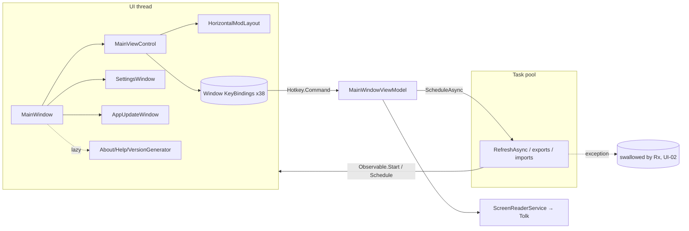

# UI: the GUI layer on master (views, controls, themes, converters, util, startup, screen reader)

Scope: `src/GUI` at `fc35358` except `MainWindowViewModel.cs`, `SettingsWindowViewModel.cs`, `AppUpdateWindowViewModel.cs` and `ModUpdatesViewData.cs`, plus `src/Core/AppServices/ScreenReaderService.cs` and how CrossSpeak's native DLLs are loaded. Read-only static review. Nothing was built or run. Paths are relative to `src/GUI/` unless they start with `src/`, `External/` or `Core/`. MWVM = `ViewModels/MainWindowViewModel.cs`.

I read CLAUDE.md, AUDIT-CLAUDE.md, the plan (§0.3, §6, §7), AUDIT-PLAN.md, HARV.md (HARV-06 to HARV-19, HARV-59, HARV-67 to HARV-77), S4-final (P5) and S7 first. I skipped defects those documents already cover. Where I add something to a known item, `knownAs` names it.

External sources I checked against: AdonisUI 1.17.1 (`scratchpad/adonis/src/src/AdonisUI/ResourceLocator.cs`), CrossSpeak submodule (`External/CrossSpeak/CrossSpeak/ScreenReaderWindows.cs`), System.Reactive 6.0.1 `Concurrency/Scheduler.Async.cs` (fetched to `scratchpad/dl-rx/`). WPF behaviour (KeyGesture validation, routing, automation peers) is cited from memory of the dotnet/wpf source and flagged where it matters.

---

## Map

### Files and responsibilities

| Area | Files | Role |
|---|---|---|
| Entry | `Program.cs` (54), `App.xaml(.cs)` (11/84), `AppCommands.cs`, `Usings.cs` | `_Lib` assembly resolver, splash, service registration, AutoUpdater hook, culture override, window class handler |
| Shell | `Views/MainWindow.xaml(.cs)` (60/478) | Exception handlers, logging toggle, window geometry save/restore, theme fan-out to other windows, creates `MainWindowViewModel` + `MainViewControl` in code, owns the secondary windows |
| Main view | `Views/MainViewControl.xaml(.cs)` (524/353) | Menus generated from `AppKeys` by reflection, window-level `KeyBinding`s, toolbar command bindings, order rename via an editable ComboBox, busy overlay, status bar and alert bar |
| Lists | `Views/HorizontalModLayout.xaml(.cs)` (227/947), `Controls/ModListView.cs`, `Controls/ModEntryGrid.cs` | Keyboard moves (Enter, Alt+arrows), focus moves, column sort, name-column autosize, selection sync (render/selection path is another reviewer's) |
| Secondary windows | `HideWindowBase.cs`, `SettingsWindow`, `AboutWindow`, `HelpWindow`, `VersionGeneratorWindow`, `AppUpdateWindow`, overlays `DeleteFilesConfirmationView`, `ExportOrderToArchiveView` (unused), `ModUpdatesLayout` (dead UI) | Hide-on-close singletons. The Settings window is generated by reflection |
| Controls | `Markdown.cs` (1,272), `AutoGrid.cs`, `AlertBar`, `BusyIndicator`, `HotkeyEditorControl`, `HyperlinkText`, `AutoGrayableImage`, `UnfocusableTextBox`, `SelectableTextBlock`, `CircleDecorator`, `AutomationTooltip`, `Behavior/*`, `Extensions/*`, `TemplateSelectors/*` | |
| Theme | `Themes/MainResourceDictionary.xaml` (1,421, 97 keys), `Light.xaml`/`Dark.xaml` (key parity: OK, 10 keys each), `DefaultStyles/ComboBox.xaml`, `MarkdownStyle.xaml`, `DivinityColors.cs` | AdonisUI-based. Colours via `DynamicResource` (no `StaticResource` to theme brushes found) |
| Util | `ElementHelper`, `FocusHelper`, `BindingHelper`, `LogTraceListener`, `RxExceptionHandler` (dead after the VM exists), `CustomPropertyResolver`, `ScreenReader/*` peers | |
| Screen reader | `src/Core/AppServices/ScreenReaderService.cs`, `External/CrossSpeak` (Tolk via `TolkDotNet.dll`) | Native `Tolk.dll`, `nvdaControllerClient64.dll`, `SAAPI64.dll` are copied to `_Lib` in every configuration (`GUI.csproj:85-90`) and preloaded with `LoadLibraryA` |

### Startup call chain

```
Program.Main                                   Program.cs:38
 ├─ AppDomain.AssemblyResolve += ResolveAssembly  :41   (Assembly.LoadFile(_Lib\<name>.dll), :13-29)
 ├─ new SplashScreen(...).Show(false,false)       :43-44
 └─ new App() → App..ctor                         App.xaml.cs:25  (FileWatcher, ScreenReaderService, HttpClient, AppUpdateWindowViewModel, Release: RxExceptionHandler)
    └─ app.Run → App.OnStartup                     App.xaml.cs:59
        ├─ Language override, Window PreviewMouseDown class handler   :64-68
        ├─ new MainWindow()                         :75 → MainWindow.xaml.cs:367
        │   ├─ InitializeComponent (merges MainResourceDictionary)
        │   ├─ 'debug' file → ToggleLogging        :380-384
        │   ├─ DispatcherUnhandledException / AppDomain.UnhandledException handlers   :388-389  ← first handlers in the process
        │   ├─ new MainWindowViewModel()           :396
        │   ├─ new MainViewControl(this, vm)       :397   (merges MainResourceDictionary again; builds HorizontalModLayout, DeleteFilesView, ModUpdatesLayout, AlertBar)
        │   ├─ new SettingsWindow(); Init(vm)      :400-409  (reflection-generated settings grid)
        │   └─ new AppUpdateWindow()               :411
        ├─ splash thread: Splash.Close(1s)          :70-76  (marshals back to the UI thread via Dispatcher.Invoke)
        └─ mainWindow.Show()
            └─ Loaded → MainWindow.WhenActivated   :445
                ├─ vm.OnViewActivated              MWVM:4105 (LoadSettings, LoadKeybindings, ApplyWindowPosition, RefreshAsync on the task pool)
                └─ MainView.OnActivated            MainViewControl.xaml.cs:268 → RegisterKeyBindings :33 (one window KeyBinding per Hotkey)
```

### Threading model

- One UI thread (STA, WPF Dispatcher). `RxApp.MainThreadScheduler` is the Dispatcher. Work is handed off with `RxApp.TaskpoolScheduler.ScheduleAsync` (17 sites in GUI) and marshalled back with `Observable.Start(..., MainThreadScheduler)` or `.Schedule`.
- The views add subscriptions mostly inside `WhenActivated`. `HorizontalModLayout`, `DeleteFilesConfirmationView`, `AboutWindow`, `HelpWindow`, `VersionGeneratorWindow` and `AppUpdateWindow` dispose them with `d(...)`. `MainWindow`, `MainViewControl.OnActivated`, `ModUpdatesLayout` and `SettingsWindow.Init` don't, and `Hotkey.AddAction` calls are never undone. That is harmless only because every view here is activated once per process. I checked that nothing toggles `IsHitTestVisible` on an ancestor, which would re-activate a ReactiveUI view. The Xceed busy template toggles `IsEnabled` (`Themes/MainResourceDictionary.xaml:1098-1125`), which does not.
- `AlertBar` posts to the `SynchronizationContext` it captured in its ctor (`Controls/AlertBar.xaml.cs:32`), so it is thread-safe. The screen-reader probe runs on whatever thread calls it, including loader pool threads (HARV-73, S4-final P5).
- Exceptions: `Application.DispatcherUnhandledException` and `AppDomain.UnhandledException` (MainWindow.xaml.cs:388-389), `RxApp.DefaultExceptionHandler` (MainWindowExceptionHandler, logs only, HARV-06). There is no `TaskScheduler.UnobservedTaskException` handler (grep), which matters for UI-02.



---

## Findings

### [High] UI-01: Binding a hotkey to a plain letter (or Shift+letter/digit) crashes every later startup

- **Location:** `Views/MainViewControl.xaml.cs:35-42` (`new KeyBinding(key.Command, key.Key, key.Modifiers)`); `Controls/HotkeyEditorControl.xaml.cs:64-121` (accepts any key); `ViewModels/AppKeys.cs:200-222` (`LoadKeybindings`, no validation); `Views/MainWindow.xaml.cs:127-150`.
- **What:** The keybinding editor accepts any key with any modifiers, for example `D`, `Shift+D` or `Shift+1`. The public `KeyBinding(ICommand, Key, ModifierKeys)` ctor builds `new KeyGesture(key, modifiers)`. That ctor validates the pair and throws `NotSupportedException` for A-Z or 0-9 without Ctrl, Alt or Win. A live rebind goes through `KeyBinding.Key`/`Modifiers` property bindings (`:38-40`), which create the gesture without validation, so the session in which the user rebinds keeps working. The failure only shows on the next launch.
- **Failure scenario:** The user rebinds "Toggle Light/Dark" to `L` and saves (`keybindings.json` stores non-default keys). On the next start, `MainView.OnActivated` → `RegisterKeyBindings` throws inside the Loaded handler. `OnUIException` sees `IsInitialized == false` and shows "An exception in the UI occurred. The program will close." Then `Shutdown(1)`. This happens on every launch until the user finds and edits `Data/keybindings.json`. In the session where the key was bound, typing that letter anywhere that doesn't handle KeyDown (combo boxes, buttons, list rows) also fires the command.
- **Evidence:** `var keyBinding = new KeyBinding(key.Command, key.Key, key.Modifiers);` (`:37`). `SetKeybind(key, modifiers);` (`HotkeyEditorControl.xaml.cs:120`) accepts anything except bare modifier keys. `existingHotkey.Key = kvp.Value.Key;` (`AppKeys.cs:212`). WPF `KeyGesture.IsValid` rejects letters and digits without Ctrl, Alt or Win (dotnet/wpf `KeyGesture.cs`, from memory).
- **Fix:** In `RegisterKeyBindings`, create `new KeyBinding { Command = ... }` and set only the property bindings, which skip validation. Or wrap each binding in try/catch, reset invalid keys to default and `ShowAlert`. In the editor, reject (or warn about) gestures that fail `KeyGesture.IsValid` semantics, and detect duplicates: two window bindings with the same gesture silently shadow each other.
- **Confidence:** Confirmed in code. That the KeyGesture ctor throws is WPF behaviour I know well. Reproduce on Windows by binding `L` and restarting.

### [Medium] UI-02: Exceptions inside `ScheduleAsync` bodies are swallowed, with no log, no alert and the busy overlay left up

- **Location:** 17 `RxApp.TaskpoolScheduler.ScheduleAsync(async ...)` sites in GUI, for example MWVM:4145-4166 (startup refresh) and MWVM:3537-3544 (zip export). System.Reactive 6.0.1 `Concurrency/Scheduler.Async.cs:23-33, 475`. `App.xaml.cs`/`MainWindow.xaml.cs` (no `TaskScheduler.UnobservedTaskException` handler).
- **What:** This answers AUDIT-CLAUDE gap 14. For a `Task<IDisposable>` body, Rx runs `t.Exception?.Handle(e => e is OperationCanceledException)` inside a `ContinueWith` whose own task nobody observes. For a `Task` body it adds `.ContinueWith(_ => Disposable.Empty)`, which ignores the fault. Either way the exception never reaches `RxApp.DefaultExceptionHandler`, the Dispatcher handler or the AppDomain handler. At most it becomes an unobserved-task event at GC time, which nothing logs.
- **Failure scenario:** `RefreshAsync` has no outer try (MWVM:2340-2455). If anything in it throws, for example a malformed profile or an unexpected null in order building, the startup "Loading..." overlay stays up with `IsRefreshing = true` and the app looks hung. Even with logging on there is no log line. The same applies to export and import bodies that throw after `MainProgressIsActive = true`.
- **Evidence:** `action(...).ContinueWith(static (t, thisObject) => { ... t.Exception?.Handle(static e => e is OperationCanceledException); @this._run.Disposable = t.Result; }, ...)` (Rx `Scheduler.Async.cs:23-33`). `grep UnobservedTaskException src` = 0.
- **Fix:** Add a house helper, for example `RxApp.TaskpoolScheduler.ScheduleAsyncSafe(...)`, that wraps the body in try/catch, logs, resets `MainProgressIsActive`/`IsRefreshing` on the UI thread and calls `ShowAlert(Danger)`. Also hook `TaskScheduler.UnobservedTaskException` in `App` to log. This fits with HARV-06's `fix/surface-command-errors`.
- **Confidence:** Confirmed for the swallowing (Rx source). Plausible for specific triggers: throw inside `RefreshAsync` in a Debug build and watch the overlay.

### [Medium] UI-03: Startup and fatal-error handling can fail silently, or throw inside the handler itself

- **Location:** `Program.cs:38-53`, `App.xaml.cs:25-57, 59-78`, `Views/MainWindow.xaml.cs:68-69, 97-173, 367-397`.
- **What:** (a) No handler exists until `MainWindow.xaml.cs:388`. A failure in `Program.Main`, the `App` ctor (services, `ScreenReaderService`, AutoUpdater), `OnStartup` or MainWindow's XAML parse crashes with only a WER dialog, no log and the splash still showing. (b) All three error paths pass `MessageBoxStyle`, which is `MainView.MainWindowMessageBox_OK.Style`. If `new MainWindowViewModel()` (`:396`) throws, `MainView` is still null and the handler itself throws `NullReferenceException`. (c) `OnUnhandledException` runs on the faulting thread, often a pool thread. There it creates an Xceed window (needs STA) and calls `App.Current.Shutdown` (needs the Dispatcher), so it throws and the user sees nothing. (d) The splash is closed only after `new MainWindow()` returns (`App.xaml.cs:75-76`).
- **Failure scenario:** A broken `Data/settings.json` field type, a missing `_Lib` DLL in a Publish zip, or an exception in the VM ctor makes the app vanish (or hang on the splash) with nothing to report.
- **Evidence:** `public Style MessageBoxStyle => MainView.MainWindowMessageBox_OK.Style;` (`:69`). Handlers are attached at `:388-389`, after `InitializeComponent()` at `:369`.
- **Fix:** Install the Dispatcher, AppDomain and `TaskScheduler` handlers in `Program.Main` before `new App()`. Have them write a crash file directly (no Trace dependency) and use `System.Windows.MessageBox` via `Dispatcher.Invoke` when one is available, with `MessageBoxStyle` null-safe. Close the splash in a `finally`.
- **Confidence:** Confirmed (code paths). (c) is standard WPF threading behaviour.

### [Medium] UI-04: The busy overlay does not block hotkeys, so F5, Ctrl+R, Ctrl+E and Delete run during an export or import

- **Location:** `Views/MainViewControl.xaml:92` (BusyIndicator wraps the content), `Themes/MainResourceDictionary.xaml:1098-1125` (busy only sets `content.IsEnabled=False`), `Views/MainViewControl.xaml.cs:37-41` (KeyBindings live on the *window*), `ViewModels/AppKeys.cs:238` (`!IsLocked`), MWVM:4933 (`IsLocked = IsDragging || IsRefreshing || IsLoadingOrder`), MWVM:4976-4993, MWVM:5006.
- **What:** The overlay only disables the content subtree. `MainWindow.InputBindings` sit above it and still execute. A zip export or archive import sets `MainProgressIsActive` but not `IsLocked`. Also `canStartExport = this.WhenAny(x => x.MainProgressToken, (t) => t != null)` is always true, because `t` is the `IObservedChange`, not the token.
- **Failure scenario:** During a long export (27 GB of paks), the user presses F5. `RefreshAsync` rebuilds `ActiveMods`/`mods` while the export enumerates them off-thread (HARV-34). The export throws "collection was modified" (and with UI-02 nothing reports it) or writes a partial zip (HARV-22), and the refresh's completion hides the overlay while the export is still running. Ctrl+R starts a second concurrent export and replaces `MainProgressToken`, so Cancel no longer reaches the first one.
- **Evidence:** As cited. `RefreshCommand` canExecute is only `!IsRefreshing`.
- **Fix:** Add `!MainProgressIsActive` to `AppKeys`' `baseCanExecute` (allowing only Cancel, Escape and the screen-reader keys), or put progress into `IsLocked`. Fix `canStartExport` to `WhenAnyValue(x => x.MainProgressToken, t => t == null)`.
- **Confidence:** Plausible. The binding and canExecute chain is confirmed. Press F5 mid-export on Windows to confirm the collision.

### [Medium] UI-05: Renaming an order that has no file yet fails with an error dialog, or crashes for archive-imported orders

- **Location:** `Views/MainViewControl.xaml.cs:161-216` (`:174-179` sits outside the try, `:194` `File.Move`); MWVM:2056-2061 (New sets a `FilePath` but writes no file); MWVM:3372-3381 (archive-imported orders get no `FilePath`); `src/Core/Models/DivinityLoadOrder.cs:29` (`FilePath` is not `[DataMember]`).
- **What:** Rename always moves `order.FilePath`. A brand-new order (Ctrl+N) has a path but no file. An imported order has `FilePath == null`, so `Path.GetDirectoryName(null)` returns null and `Path.Combine(null, …)` throws outside the try.
- **Failure scenario:** (1) Ctrl+N, then rename "New3" to "Tactician run": `File.Move` throws `FileNotFoundException`, the user gets a red alert plus a "Failed to Rename Order" dialog with a stack trace, and the name reverts. The user has to save first, which nothing tells them. (2) Rename an order that came from a zip import: `ArgumentNullException` escapes into the Dispatcher and shows "An exception in the UI occurred". Also, when overwriting, the replaced order is removed from `ModOrderList` only (`:195-199`), not from `SavedModOrderList`, so the next `BuildModOrderList` brings it back pointing at the renamed file. Two entries then share one path.
- **Evidence:** `var directory = Path.GetDirectoryName(lastFilePath);` (`:177`), then `File.Move(lastFilePath, nextFilePath, true);` (`:194`).
- **Fix:** If `FilePath` is empty or the file is missing, just set `Name`/`FilePath` (save later). Otherwise move. Move the path computation inside the try. Remove the overwritten order from `SavedModOrderList` too. This is upstreamable.
- **Confidence:** Confirmed (static).

### [Medium] UI-06: Light theme is not applied to lazily created windows or to popup message boxes

- **Location:** `App.xaml:5-7` (merges `Light.xaml`, then `Dark.xaml`, so Dark wins at app level); `Views/MainWindow.xaml.cs:325-345` (`UpdateColorTheme` patches only the windows that exist); lazy creation at `:281-284` (About), `:300-303` (Help), `:457-460` (Version Generator); MWVM:1012-1016 (theme applied only on change, `.Skip(1)`); about 18 `Xceed.Wpf.Toolkit.MessageBox.Show` sites.
- **What:** The theme is a per-window merged dictionary, and the app-level fallback is always Dark. A window created after the switch never receives it. An Xceed `MessageBox.Show` opens a new top-level Window whose `DynamicResource` lookups go message box → new window → Application, never through the owner.
- **Failure scenario:** A Light-mode user presses F1. About opens Dark. So do Version Generator and Help, and every confirmation dialog (zip export, overwrite order, admin warning) has Dark colours over a Light app. They stay that way until the user toggles the theme twice.
- **Evidence:** `ResourceLocator.SetColorScheme(this.Resources, …)` per window. AdonisUI `ResourceLocator.cs:51-66` adds and removes within the passed dictionary only.
- **Fix:** Apply the scheme once at app level: `ResourceLocator.SetColorScheme(Application.Current.Resources, uri)`. Merge only one of `Light.xaml`/`Dark.xaml` in `App.xaml`, chosen at startup from settings. Delete the per-window list. This also retires plan §11's "add a line to UpdateColorTheme for any new window" rule (see UI-21).
- **Confidence:** Confirmed for the lazy windows. Plausible for the message boxes; open one in Light mode on Windows to check.

### [Medium] UI-07: Custom automation peers strip the lists' and window's UIA patterns and walk the whole visual tree on every query

- **Location:** `Controls/ModListView.cs:209-212` → `Util/ScreenReader/ModListViewAutomationPeer.cs`; `Views/MainWindow.xaml.cs:320-323` and `Views/MainViewControl.xaml.cs:126-129` → `CachedAutomationPeer`; `Util/ScreenReader/CachedAutomationPeer.cs:52-80`; `ModEntryGridAutomationPeer.cs:30-46`.
- **What:** (a) `ModListView` returns a `FrameworkElementAutomationPeer` subclass instead of `ListViewAutomationPeer`. The lists lose Selection, Scroll, ItemContainer and VirtualizedItem patterns, and rows become `ListBoxItemWrapperAutomationPeer`s without SelectionItem. This is why plan §0.3 found "the lists expose no ScrollPattern". (b) The window gets a Custom-typed peer instead of `WindowAutomationPeer`, and `MainWindowAutomationPeer` is never used. (c) The "cache" never hits: the base `HasNullChildElement` uses `FindVisualChildren`, which never yields null. So each `GetChildren` walks the full visual subtree twice. `ModListViewAutomationPeer.HasNullChildElement` scans all 935 items. (d) `ModEntryGridAutomationPeer.HasNullChildElement` always returns true, so its `GetChildrenCore` returns the never-assigned `_cachedAutomationPeers`, which is null. (e) `LiveRegionChanged` is raised (`AlertBar.xaml.cs:99-110`, `HorizontalModLayout.xaml.cs:648-672`), but no element sets `AutomationProperties.LiveSetting`, so Narrator ignores it.
- **Failure scenario:** NVDA or Narrator users can't hear "selected" or "N of M" on rows, and UIA tools can't scroll the list. Any UIA client attached (Narrator, touch keyboard, some password managers) pays full-tree walks. This is the plan §6.1 "outside client" cost of up to 5.3 s.
- **Fix:** Derive `ModListViewAutomationPeer` from `ListViewAutomationPeer` (override only `GetNameCore`), drop `CachedAutomationPeer` from MainWindow and MainViewControl, delete `ModEntryGridAutomationPeer`'s dead child logic, and set `LiveSetting="Polite"` on the alert text and the selection counters.
- **Confidence:** Confirmed (code). Plausible for the screen-reader impact; check with NVDA and Accessibility Insights.

### [Medium] UI-08: The changelog Markdown renderer fetches images from any URL or UNC path in a public wiki page

- **Location:** `Controls/Markdown.cs:430-493` (`ImageInlineEvaluator`: `:442` keeps rooted or UNC paths, `:453` `new Uri(url)`, `OnLoad`); `src/Core/DivinityApp.cs:21` (`URL_CHANGELOG_RAW` = the GitHub *wiki* `Changelog.md`); `ViewModels/AppUpdateWindowViewModel.cs:57-66`; `Views/AppUpdateWindow.xaml.cs:50`; `Themes/DefaultStyles/MarkdownStyle.xaml:60` (`AssetPathRoot` = current directory).
- **What:** Every user's update window renders the raw wiki page. `` or `file://host/a.png` makes WPF open an SMB connection (NTLM hash leak, and a synchronous UI-thread stall). `https://` images leak the IP address. GitHub wikis on public repos can be editable by any signed-in user unless the owner ticks "Restrict editing to collaborators".
- **Failure scenario:** Someone edits the wiki and adds a UNC image. Every user who opens the update dialog leaks NTLM credentials to that host and freezes while SMB times out. Once Stage 1 repoints the URL, the same applies to the fork's wiki.
- **Fix:** Allow only `https` images from an allow-list (or none), reject `file:`/UNC, and load them asynchronously. Point `URL_CHANGELOG_RAW` at a file in the repo (commit-controlled) rather than the wiki. For the fork, restrict wiki editing.
- **Confidence:** Plausible. The code path is confirmed. The wiki edit permissions need a check in repo settings, and the SMB attempt needs a Windows run with Procmon.

### [Medium] UI-09: Window placement has bugs that will surface once `Settings.Window` is restored, and the app is not per-monitor-DPI aware

- **Location:** `Views/MainWindow.xaml.cs:175-189, 205-239, 347-352`; MWVM:4130-4133; `app.manifest` (no `dpiAwareness`); root cause `src/Core/Models/DivinityModManagerSettings.cs:112` + MWVM:1127.
- **What:** Today the saved geometry is never restored, because `Window` lacks `[Reactive]` (AUDIT-CLAUDE gap 1). Fixing that exposes the following. (a) `if (winX < 0) winX = Left;` discards legitimate negative coordinates of monitors left of or above the primary. (b) There is no check against the current monitors, so a window saved on a disconnected screen opens off-screen. (c) The minimized position (-32000) can be saved through `StateChanged`. (d) `OnClosing` runs from `Closed`, after the HWND is gone, so `Screen.FromHandle` may resolve to the primary monitor. (e) The position is applied after Loaded, so the window visibly jumps. (f) System-DPI awareness makes text blurry on a second monitor with different scaling.
- **Failure scenario:** On a laptop with an external monitor on the left: the window opens on the laptop screen every time. After undocking, it opens off-screen.
- **Fix:** Save `RestoreBounds` plus `WindowState` (skip Minimized), validate the result against `Screen.AllScreens` working areas, apply it in `OnSourceInitialized` before Show, and save in `Closing`. Add `PerMonitorV2` to the manifest and re-test layout.
- **Confidence:** Confirmed for (a), (b), (e) and the gap. Plausible for (c), (d), (f) (Windows run).

### [Low] UI-10: `MainResourceDictionary.xaml` is parsed 15 times, including once per keybinding row

- **Location:** 15 `Source="../Themes/MainResourceDictionary.xaml"` merges (MainWindow, MainViewControl, HorizontalModLayout, DeleteFilesConfirmationView, ModUpdatesLayout, AlertBar, SettingsWindow, AppUpdateWindow, ...); `Controls/HotkeyEditorControl.xaml:18-24` sits in the keybindings `CellTemplate` (`Views/SettingsWindow.xaml:258`).
- **What:** WPF creates a new dictionary instance, with its own BAML load, its nested `ComboBox.xaml` + AdonisUI `TextBox.xaml`, and its own converters, styles and BitmapImages, for every `Source=` merge. At least 9 of these happen before first paint. The keybindings tab adds about 38 more (one per `HotkeyEditorControl`).
- **Failure scenario:** Startup and opening Preferences → Keybindings pay repeated BAML parses (estimated 2-10 ms each, so roughly 50-100 ms at startup and 0.1-0.4 s on the tab). It also duplicates shared resources such as `ModToolTip` per view. The cost is not measured.
- **Fix:** Merge it once in `App.xaml` after the AdonisUI ClassicTheme and remove the per-view merges (keep `MarkdownStyle.xaml` where used). Measure with the PerfProbe rig.
- **Confidence:** Confirmed (count). Plausible (cost).

### [Low] UI-11: The inactive list's user-resize detection watches the wrong column, so autosize overrides the user's Name width

- **Location:** `Controls/ModListView.cs:122-137` (`grid.Columns[1]`); `Themes/MainResourceDictionary.xaml:933-938` (`InactiveModGridView`: Name is column 0); `Views/HorizontalModLayout.xaml.cs:863-918` (sets `Resizing = true` and `Columns[0].Width`).
- **What:** `NameColumnWidthChanged` is hooked to column 1, which is Version on the inactive list. Resizing Name there never sets `UserResizedColumns`. The `Resizing = true` set before autosizing column 0 is never consumed, so the user's *next* Version resize is ignored too. `HideHeader` is read in the ctor before XAML sets it, so the guard at `:122` is always true.
- **Failure scenario:** The user widens Inactive → Name. The next order or profile switch or F5 (`OrderJustLoaded`) snaps it back.
- **Fix:** Look the column up by the `ModNameTemplate` cell template or the header, not by index. Move the hook to `OnApplyTemplate`/Loaded once, and reset `Resizing` after the write.
- **Confidence:** Confirmed.

### [Low] UI-12: `SettingsWindowIsOpen` stays true after Preferences is closed with X or Esc

- **Location:** `Views/MainWindow.xaml.cs:260-277, 400-407`; `Views/HideWindowBase.cs:42-63`; consumers MWVM:798, 819, 1091, 1100; `src/Core/Models/DivinityModManagerSettings.cs:190-212`.
- **What:** The flag is set by `OpenPreferences`, and cleared only by the same toggle or by `Closed`. `HideWindowBase` cancels Closing, so `Closed` never fires. The X button and Esc just `Hide()`.
- **Failure scenario:** After closing Preferences with X, "Skip Launcher - Created steam_appid.txt" alerts go to the hidden settings window, `WriteInsanityCheck` is suppressed (MWVM:1100), and every settings change marks `CanSaveSettings`.
- **Fix:** Drive the flag from `SettingsWindow.IsVisibleChanged`, or replace it with `Window.SettingsWindow.IsVisible`.
- **Confidence:** Confirmed.

### [Low] UI-13: MoveFocusRight checks the active list's selection count, and the Overrides list lacks Ctrl+A/Ctrl+D

- **Location:** `Views/HorizontalModLayout.xaml.cs:589-602` (`:595`); `:95-121, 465-466` (`SetupListView` is not applied to `ForceLoadedModsListView`).
- **What:** A copy-paste slip: `if (ViewModel.ActiveSelected <= 0) InactiveModsListView.SelectedIndex = 0;`.
- **Failure scenario:** With five mods selected in Inactive and none in Active, focus in Active, the user presses Right. The inactive multi-selection collapses to row 0, which may be a filtered-out, hidden row. With Active selected and Inactive empty, nothing gets selected.
- **Fix:** Use `InactiveSelected` and pick the first *visible* row. Call `SetupListView(ForceLoadedModsListView)`.
- **Confidence:** Confirmed.

### [Low] UI-14: The screen-reader DLL preload uses an ANSI path and ignores failure

- **Location:** `src/Core/AppServices/ScreenReaderService.cs:49-80`; `src/Core/Util/NativeLibraryHelper.cs:6-7` (`LoadLibraryA`, `LPStr`); CrossSpeak `ScreenReaderWindows.cs:15-33`.
- **What:** The full `_Lib\Tolk.dll` path is marshalled to the ANSI code page and the returned handle is never checked. `Tolk.dll` lives only in `_Lib`, which is not on any probe path (`DisableCrossSpeakLib=True` stops CrossSpeak's own copy). If the preload fails, every `Tolk.Load()` throws `DllNotFoundException`. This adds to HARV-73, where the probe runs about 4,000 times per startup with no reader.
- **Failure scenario:** The app sits under a folder with characters outside the system code page (for example a CJK user name on an en-US system). About 4,000 first-chance `DllNotFoundException`s per startup inside `HasToolTip` (each swallowed by the OAPH and logged by `MainWindowExceptionHandler`), and screen-reader output never works.
- **Fix:** `NativeLibrary.TryLoad(path, out _)` (Unicode, returns success). Log once on failure. Memoise "unavailable" alongside S4 P5.
- **Confidence:** Plausible (needs a non-ANSI path on Windows).

### [Low] UI-15: Markdown control robustness: a null input throws, links do nothing, Help is unstyled

- **Location:** `Controls/Markdown.cs:189-193` (`Transform(null)` throws); `:186, 525` (links use `NavigationCommands.GoToPage`, which no one handles); `:770-818` (`new Regex` per list at `:807`); `Views/HelpWindow.xaml:15-21` (doesn't merge `MarkdownStyle.xaml`, so `DefaultMarkdown` is never found); `Views/AppUpdateWindow.xaml.cs:50`.
- **What:** `UpdateChangelogView` starts null and stays null when the download fails (`WebHelper` returns ""). The first time the update window is shown, `StringToMarkdown(null)` throws inside the `OneWayBind`, so that binding stops updating for the session. Changelog links are inert. No regex has a timeout, though all current inputs are trusted.
- **Failure scenario:** Offline start, then the user checks for updates again later: the window shows no changelog even after a later fetch succeeds. A user clicks a changelog link and nothing happens.
- **Fix:** `Transform(text ?? "")`. Set `HyperlinkCommand` to a command that opens only `https` URLs through the shell. Merge `MarkdownStyle.xaml` in `HelpWindow`. Cache the list-item regexes.
- **Confidence:** Confirmed (code). Plausible that the binding dies rather than logs (ReactiveUI binding error handling).

### [Low] UI-16: The delete dialog's column sizing can set a negative `GridViewColumn.Width`

- **Location:** `Views/DeleteFilesConfirmationView.xaml.cs:34-49, 95`.
- **What:** `width = ActualWidth - scrollbar - col0 - nameWidth` is not clamped. `GridViewColumn.Width` reuses `FrameworkElement.WidthProperty`, whose validation rejects negative values. Also `SizeChanged +=` is added inside `WhenActivated` without disposal.
- **Failure scenario:** Deleting a duplicate pak whose name is wider than the window minus the checkbox column (a narrow window, or 100+ character names) throws `ArgumentException` from a SizeChanged handler. The user sees "An exception in the UI occurred".
- **Fix:** `Math.Max(0, width)`. Measure with `FormattedText` (AUDIT-PLAN-14). Attach `SizeChanged` once in the ctor.
- **Confidence:** Plausible (the validation callback on the shared DP should be checked on Windows).

### [Low] UI-17: Log path scrubbing misses lower-case and forward-slash forms of the user profile

- **Location:** `Util/LogTraceListener.cs:19-33`.
- **What:** The listener only does an ordinal, case-sensitive `Replace` of three exact paths. Paths reach the log as `c:\users\name\…` (user-typed settings), `C:/Users/name/…` (JSON, LSLib, URIs) or `C:\Users\NAME~1\…` (8.3 names). None of those are scrubbed, nor is a Documents folder redirected to another drive.
- **Failure scenario:** The bug-report template asks for a debug log (`.github/ISSUE_TEMPLATE/bug-report.yaml:48`), and users post their Windows user name publicly.
- **Fix:** Use a case-insensitive regex that accepts both separators and also covers `Environment.UserName` as a path segment.
- **Confidence:** Confirmed.

### [Low] UI-18: Window-level, modifier-free bindings swallow arrows, Delete and Enter outside the lists

- **Location:** `Views/MainViewControl.xaml.cs:44-53` (Up/Down `setInitialFocusCommand`, always executable); `ViewModels/AppKeys.cs:61-70, 85` (Enter, Left, Right, Delete).
- **What:** This extends HARV-10, which covers Tab, to other keys. A `KeyBinding` that executes marks the key handled. Up and Down are therefore consumed for every focused element that doesn't handle them itself (toolbar buttons, the status bar), which breaks directional focus navigation and can jump focus into the Active list. Left and Right behave the same through MoveFocusLeft/Right.
- **Failure scenario:** A keyboard user tabs to the toolbar and presses Down or Right to reach the next button. Focus jumps into a mod list instead.
- **Fix:** Give these hotkeys a `canExecute` of "a mod list has keyboard focus" (the same fix as HARV-10), or handle them in `HorizontalModLayout` instead of on the window.
- **Confidence:** Plausible (Windows keyboard test).

### [Info] UI-19: The `_Lib` resolver works, but loads each assembly into its own load context and ignores versions

- **Location:** `Program.cs:13-29, 40-41`.
- **What:** `Assembly.LoadFile` puts each assembly in a separate `AssemblyLoadContext` keyed by path, ignores the requested version and public key, and has no logging. Type identity holds today only because each path resolves to one file. The trust boundary is the same as the exe folder (`AppContext.BaseDirectory`), so this is not a security hole. The splash "thread" only blocks on `Dispatcher.Invoke`, so the fade really runs on the UI thread while `OnViewActivated` is busy.
- **Failure scenario:** A future dependency loaded by path or by `AssemblyLoadContext.Default.LoadFromAssemblyName` behaves differently in Debug and Publish (CLAUDE.md §2.4).
- **Fix:** `AssemblyLoadContext.Default.Resolving += (ctx, n) => File.Exists(p) ? ctx.LoadFromAssemblyPath(p) : null;`, and log misses. Close the splash with `Dispatcher.BeginInvoke` after `ContentRendered`.
- **Confidence:** Confirmed.

### [Info] UI-20: No URL from mod metadata reaches a launcher today, but `TryOpenUrl` is a foot-gun

- **Location:** `src/Core/Util/ProcessHelper.cs:88-112`; callers `Controls/HyperlinkText.xaml.cs:69`, `Controls/Extensions/HyperlinkExtensions.cs:38`, `src/Core/Util/DivinityGlobalCommands.cs:85-109`.
- **What:** Mod-derived links are built from numeric IDs (`DivinityModData.GetURL`), and Markdown links are inert (UI-15). However, `TryOpenUrl` first calls `Process.Start(url)` *without* the shell, which executes `url` as a program path, and only falls back to ShellExecute on error.
- **Failure scenario:** None today. If a later feature (a downloader, update links, Markdown descriptions) passes metadata such as `C:\…\evil.exe` or `cmd`, it runs.
- **Fix:** Accept only `Uri` with `https`/`http` (and an explicit `steam://` whitelist) and use `UseShellExecute = true` once.
- **Confidence:** Confirmed.

### [Info] UI-21: Document corrections in this area

- **Plan §11 (Stage 7):** "Any new window needs a line added to MainWindow.UpdateColorTheme, or it is stuck on whatever theme was live when it was constructed." This is wrong in two ways. A window without the line is stuck on Dark, the app-level default, not on "whatever was live". Windows already listed but created lazily after a switch (About, Help, Version Generator) are stuck too. See UI-06.
- **Plan §0.3:** "The lists expose no ScrollPattern, so this could not be automated." The cause is the custom peer (UI-07). Deriving from `ListViewAutomationPeer` would give the measurement rig a ScrollPattern.
- **CLAUDE.md §4:** "[HideWindowBase windows] are constructed once and live for the process". About, Help and Version Generator are created on first use (`MainWindow.xaml.cs:281, 300, 457`), and close-to-hide leaves window-state flags stale (UI-12).
- **CLAUDE.md §4 exceptions:** add that `ScheduleAsync` bodies are swallowed entirely (UI-02), not just that ReactiveCommands only log.

---

## Opportunities aligned with the owner's intentions

**Upstreamable `fix/*` from clean master, each small and self-contained:**
- `fix/keybinding-validation` (UI-01): the biggest user-hit crash here, about 20 lines in `MainViewControl.xaml.cs` and `HotkeyEditorControl.xaml.cs`.
- `fix/order-rename-unsaved` (UI-05).
- `fix/settings-window-open-flag` (UI-12), `fix/move-focus-right` (UI-13), `fix/inactive-name-column-resize` (UI-11), `fix/delete-dialog-width` (UI-16), `fix/markdown-null` (UI-15): each is a few lines.
- `fix/surface-async-errors` (UI-02 + UI-03): a `ScheduleAsyncSafe` helper and early handlers in `Program.Main`. It pairs with HARV-06's `fix/surface-command-errors` (S7 §6) and should land before Stages 2-4 add more task-pool work.
- `fix/busy-blocks-hotkeys` (UI-04): it also protects the Stage 2 export fixes from a concurrent F5.

**Perf (`perf/*`), measure first as the owner insists:**
- One app-level `MainResourceDictionary` merge (UI-10). Measure startup to first paint and opening the Keybindings tab with PerfProbe.
- Replace the automation peers (UI-07). This removes the plan §6.1 "outside client" tree-walk cost, and the ScrollPattern lets the scroll rig, or an outside UIA driver, scroll the lists.
- Re-baseline with the `debug` file absent. The §0.3 numbers were taken with `Trace.AutoFlush = true` and the global Trace lock. Per-mod logging is mostly on error paths, so the effect is probably small, but it is unmeasured.

**Fork-only `ui/*` (Stage 7):**
- App-level theming (UI-06) before the tokens work. Then `ui/tokens` only has to keep `Light.xaml`/`Dark.xaml` in parity, and no per-window list is needed.
- `LiveSetting` plus real `ListViewAutomationPeer` (UI-07) as part of `ui/notifications` / `ui/list-chrome`. The fork keeps screen-reader support first-class.
- Window placement (UI-09) together with the AUDIT gap-1 fix. Do them in one branch, or the fix makes things worse for multi-monitor users.

**Linux / Avalonia: what in this layer blocks a port, and rough effort (focused days for one person):**

| Area | What blocks | Effort |
|---|---|---|
| Entry and startup (`Program.cs`, `App`) | WPF `SplashScreen`, `AssemblyResolve` `_Lib` scheme, AutoUpdater.NET (WinForms, Windows-only, 4 call sites) | 1-2 |
| Shell (`MainWindow`) | `AdonisWindow`, `TaskbarItemInfo`, `user32!FlashWindow`, WpfScreenHelper, Xceed `MessageBox` (about 18 sites) | 3-4 |
| Theme (`MainResourceDictionary` 1,421 lines, `ComboBox.xaml` 439) | AdonisUI keys and extensions (24 CursorSpotlight, 18 Layer, 12 Ripple, 11 CornerRadius, 5 Validation, 2 Watermark), 30 DataTriggers and about 72 MultiDataTriggers (no `DataTrigger` in Avalonia), 21 ControlTemplates, `DropShadowEffect`s, 18 Storyboards | 6-9 |
| Lists (`HorizontalModLayout` 947 + `ModListView` 314 + templates) | `ListView`/`GridView`, `ItemContainerGenerator`, reflection into `ListBox` internals (`UpdateAnchorAndActionItem`, `ItemInfoFromContainer`, `GridViewColumn.ActualIndex`), gong-wpf-dragdrop (14 uses), `CollectionViewSource` sorting, plus the Stage 6.1 `CachedTextBlock` (`FormattedText`/`GlyphRun` reflection) | 8-12 |
| Settings generator, hotkeys | Reflection generator is portable. Xceed `IntegerUpDown`/`ULongUpDown` → `NumericUpDown`. WPF `KeyBinding` → Avalonia `KeyBinding` (similar) | 2-3 |
| Markdown (`Markdown.cs`) | `FlowDocument`. Replace with Markdown.Avalonia (upstream avalonia already uses a MarkdownViewer fork) | 0.5 |
| AlertBar, BusyIndicator, dialogs | Storyboards, `ClassicBorderDecorator` (`Microsoft.Windows.Themes`), Xceed `WindowContainer` | 2 |
| Accessibility | 6 custom WPF peers, `ScreenReaderHelperBehavior`. Avalonia's automation API differs. CrossSpeak already has a speech-dispatcher backend on Linux | 2-3 |
| Converters, util | `IValueConverter` exists in Avalonia. `BrushConverter`/`ColorConverter` → `Color.Parse` | 0.5-1 |
| **Total (this layer)** | | **about 25-37 days**, before Core (`net8.0-windows`, WPF types in models; AUDIT-CLAUDE gap 15) and the ReactiveUI.Fody → source-generator switch |

Upstream avalonia has already paid most of this (AVA.md). A cheap way to keep the port open today: behaviour into VMs (S7 §5), no new code-behind keyboard logic (UI-13 and UI-18 are both code-behind), and no new reflection into WPF internals.

---

## Needs a Windows run to settle

1. **UI-01:** bind "Toggle Light/Dark" to `L`, restart, and observe the crash. Also check that the live rebind uses the unvalidated path.
2. **UI-02:** throw inside `RefreshAsync` in a Debug build and confirm the overlay sticks with nothing logged. Add a `TaskScheduler.UnobservedTaskException` probe and force a GC to see the event.
3. **UI-04:** start a zip export of the 935-mod order, press F5 or Ctrl+R mid-way, and watch for collection-modified errors or a second export.
4. **UI-06:** Light mode, then F1 (About), Ctrl+G (Version Generator) and any confirmation dialog. Check the colours.
5. **UI-07:** Accessibility Insights on the Active list (patterns present, "selected" state). Repeat with NVDA and Narrator for the alert bar and selection counts. Time a UIA `FindAll(TreeScope.Descendants)` before and after the peer change.
6. **UI-08:** check the upstream wiki's edit restriction. With Procmon/Wireshark, render a changelog containing a UNC image in a test build.
7. **UI-09 (after the gap-1 fix):** left-of-primary monitor, monitor unplugged, minimize then close, maximize then close, and 100%/150% mixed DPI.
8. **UI-10:** PerfProbe or a Stopwatch around `InitializeComponent` of MainWindow, MainViewControl and HorizontalModLayout, and time opening the Keybindings tab, before and after the single merge.
9. **UI-14:** run from a folder whose name has characters outside the ANSI code page and count first-chance `DllNotFoundException`s.
10. **UI-16:** delete a pak with a 120-character file name in a 900 px window.
11. **UI-18:** keyboard-only pass over the toolbar and menus (arrow keys, Delete, Enter) with no mod list focused.
12. **Baseline hygiene:** repeat the §0.3 cold start with and without the `debug` file to size the logging overhead.
