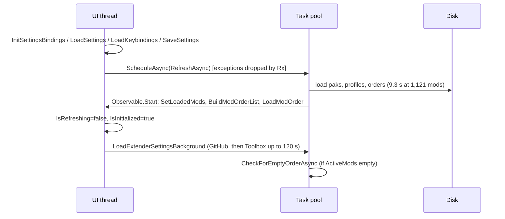

# VM1: MainWindowViewModel part 1 and app plumbing

Scope: `src/GUI/ViewModels/MainWindowViewModel.cs` (MWVM) lines 1-2560, the constructor (4891-5448) and `OnViewActivated` (4105-4166) as far as they concern these parts, `MainWindowExceptionHandler.cs`, `AppKeys.cs`, `BaseProgressViewModel.cs`, `src/Core/ViewModels/*`, `BaseHistoryObject.cs`, `DivinityGlobalCommands.cs`, `DivinityGlobalEvents.cs`, `DivinityApp.cs`, `DivinityInteractions.cs`, `ReactiveExtensions.cs`, `Hotkey.cs`, `MultiReactiveCommandHotkey.cs`, and `MainWindow.xaml.cs` where it drives the VM. I also followed calls into `DivinityRegistryHelper.cs`, `DivinityLoadOrder.cs`, `DivinityJsonUtils.cs`, `ModelExtensions.cs`, `DivinityModManagerSettings.cs`, `ScriptExtenderSettings.cs`, `ScriptExtenderUpdateConfig.cs`, `SettingsWindowViewModel.cs:290-370` and `src/Toolbox/*`.

Checked against master `fc35358`. Nothing was built or run. One external fact was checked against upstream source: Rx.NET's `ScheduleAsync` exception handling, read from `dotnet/reactive` `Concurrency/Scheduler.Async.cs` (the repo pins System.Reactive 6.0.1, `GUI.csproj:65`). Line numbers are MWVM unless a file is named.

Before writing this I read CLAUDE.md, AUDIT-CLAUDE, AUDIT-PLAN, HARV.md, LIB-final/LIB-C and S6-A, so known items are referenced, not repeated. Already covered and skipped: DWrite.dll written in place (HARV-47), `OnNext` only logging (HARV-06), LoadLibraryA (BLD-13), the profile-shared LastExported (HARV-54), unreadable modsettings read as a reset (HARV-53), single instance (HARV-67), the `(Modified)` tooltip inversion (HARV-09) and the Nexus init flag (HARV-48).

## Map

### Responsibilities inside MWVM 1-2560

| Lines | Responsibility | Key members |
|---|---|---|
| 49-326 | State: ~60 `[Reactive]` properties, 20 raw OAPHs, `SourceCache<DivinityModData,string> mods` (:82), plain `ActiveMods`/`InactiveMods` (:161-165), `Profiles`, `ModOrderList`, `SavedModOrderList`, progress fields (:257-286) | `IncreaseMainProgressValue(Async)` (:263-280) |
| 327-760 | Script Extender: `DownloadScriptExtender` (:329), `UpdateExtender` runs Toolbox (:418-470), `AskToDownloadScriptExtender` (:474), `CheckExtenderUpdaterVersion` (:513), `CheckExtenderInstalledVersion` (:563), `CheckForLatestExtenderUpdaterRelease` (:650), `LoadExtenderSettingsAsync` (:704), `LoadExtenderSettingsBackground` (:749) | `_justDownloadedScriptExtender`, `OpenRepoLinkToDownload` |
| 775-857 | Game launch helpers: `TryStartGameExe` (:775), `CreateSteamApiTextFile` (:788), `RemoveSteamApiTextFile`, `WriteInsanityCheck` (:836) | |
| 859-1110 | `InitSettingsBindings`: launch hotkey (:897-1009), about 15 settings subscriptions | |
| 1112-1279 | `LoadSettings`, `SaveSettings`, `QueueSave` | `_managerSerializerSettings` (:1229) |
| 1280-1491 | `GetLarianStudiosAppDataFolder`, `SetGamePathways` (registry, Steam libraries, GOG, override, folder dialog) | `DivinityRegistryHelper` |
| 1492-1720 | `SetLoadedMods`, `MergeModLists`, `RunTask`/`RunTaskStep`, `LoadModsAsync` (orchestration only; loader internals belong to another reviewer) | |
| 1727-1834 | `LoadProfilesAsync`, `BuildModOrderList` | `_fallbackOrder` |
| 1880-2070 | `ImportMods` orchestration, `OpenModImportDialog`, `AddNewModOrder` (the only user of undo history) | |
| 2079-2145 | `TryLoadFallbackOrder`, `LoadModOrder` | |
| 2169-2229 | extender status per mod | |
| 2262-2336 | `RefreshAllModUpdatesBackground` (dead, HARV-50), `CheckForEmptyOrderAsync` | |
| 2340-2557 | `RefreshAsync` | |

### Main flows

Startup (`App.OnStartup` → `new MainWindow()`):

```
MainWindow ctor (MainWindow.xaml.cs:367)
  ├─ debug file → ToggleLogging(true) (:380-384)
  ├─ new MainWindowViewModel()  (MWVM:4891)
  │    ├─ RxApp.DefaultExceptionHandler = MainWindowExceptionHandler (:4902-4903)
  │    ├─ AppKeys ctor: every [MenuSettings] hotkey gets !IsLocked (AppKeys.cs:235-249)
  │    └─ commands, OAPHs, DynamicData views (:4977-5448)
  ├─ ViewModel.DebugMode = true if logging is already on (:440-443)
  └─ WhenActivated → ViewModel.OnViewActivated(this, MainView) (:447)
OnViewActivated (MWVM:4105)  [UI thread]
  ├─ InitSettingsBindings()             (:4111 → :859)
  ├─ LoadSettings()                     (:4126 → :1112)
  │    ├─ SetFrom<Settings, ReactiveAttribute>, SetFrom(ExtenderSettings), SetFrom(ExtenderUpdaterSettings) (:1127-1129)
  │    ├─ LoadAppConfig() (:1138 → :4689)
  │    ├─ SetGamePathways(...) (:1159 → :1316)  may show a modal folder dialog (:1451-1478)
  │    ├─ if !loaded: SaveSettings() (:1206)  ← before LoadKeybindings (VM1-05)
  │    └─ CreateSteamApiTextFile (:1209-1212), WriteInsanityCheck if flagged (:1214-1218)
  ├─ Keys.LoadKeybindings(this)         (:4127)
  ├─ SaveSettings()                     (:4128)
  ├─ ApplyWindowPosition(Settings.Window) (:4130-4133)  (Window never restored, VM1-06)
  ├─ IsRefreshing = true (:4144)
  └─ TaskpoolScheduler.ScheduleAsync → RefreshAsync, then admin warning (:4145-4165)
RefreshAsync (MWVM:2340)  [pool thread, hops to UI via Observable.Start]
  ├─ if IsInitialized: UI{ LoadSettings() } (:2362-2368, fc35358)
  ├─ LoadModsAsync (:1609)  pool, with UI hops for progress
  ├─ LoadProfilesAsync, GetSelectedProfileUUIDAsync (first run only), LoadExternalLoadOrdersAsync
  ├─ UI{ LoadAppConfig; SetLoadedMods; Profiles.AddRange; pick profile ("Public" first);
  │      SetOrder(lastActiveOrder); BuildModOrderList(0, lastOrderName) → LoadModOrder } (:2416-2477)
  ├─ UI{ adventure mod; OnMainProgressComplete; IsRefreshing=false; IsInitialized=true;
  │      LoadExtenderSettingsBackground(); first-run update check } (:2480-2549)
  └─ if ActiveMods.Count==0: ScheduleAsync(CheckForEmptyOrderAsync) (:2551-2554)
LoadExtenderSettingsBackground (:749)  [pool]
  ├─ CheckForLatestExtenderUpdaterRelease (GitHub API, every refresh)
  ├─ LoadExtenderSettingsAsync → UI{ read SE json files; CheckExtenderUpdaterVersion; CheckExtenderInstalledVersion }
  └─ pool{ UpdateExtender → Toolbox.exe UpdateScriptExtender, WaitForExit(120 s); CheckExtenderInstalledVersion; UI{UpdateExtenderVersionForAllMods} }
```

F5 is `RefreshCommand` (:4977-4991): it clears `mods` and `Profiles` (not `ModOrderList`), sets `IsRefreshing`, then runs `ScheduleAsync(RefreshAsync)`. It is gated by `canRefreshObservable = !IsRefreshing` and the hotkey's own `!IsLocked`.

Launch is `Keys.LaunchGame` (:897-1009): `DeleteModCrashSanityCheck`, a fire-and-forget launcher-preferences rewrite (:901-907), then Exe / Steam URL / custom command, then `ActionOnGameLaunch`.



### Threading model as built

- The UI-thread entry points are commands, hotkeys, `OnViewActivated` and `InitSettingsBindings` subscriptions. Most of those subscriptions use `ObserveOn(RxApp.MainThreadScheduler)`. `LogEnabled`, `DisplayFileNames`, `DocumentsFolderPathOverride`, `NexusModsAPIKey` and `SaveWindowLocation` don't; they run on the setter's thread, which is the UI thread in practice.
- Background work goes through `RxApp.TaskpoolScheduler.ScheduleAsync` (15 sites in MWVM) and hops back with `Observable.Start(..., MainThreadScheduler)`. **Rx discards any exception from these bodies** (VM1-02).
- Hotkey commands are safe from thread issues: `Hotkey._canExecuteCommand` is an OAPH on `MainThreadScheduler` (Hotkey.cs:123), so `CanExecuteChanged` is always raised on the UI thread. Raw `ReactiveCommand`s with `WhenAnyValue` canExecute don't get that protection (VM1-08).
- The real cross-thread hazards are `ICommand.CanExecuteChanged`, collection mutations and synchronous `WhenAnyValue` subscribers that touch UI. WPF bindings already marshal plain `PropertyChanged` for scalar properties, so a Fody setter on a pool thread updating a bound `string` or `bool` is not a crash by itself (VM1-20).

## Findings

### [High] VM1-01: "Restore Load Order" restores into the wrong order and can empty LastExported itself
- **Location:** MWVM:2283-2336 (`CheckForEmptyOrderAsync`); `src/Core/Models/DivinityLoadOrder.cs:289-293` (`SetOrder(DivinityLoadOrder)`); `DivinityModDataLoader.cs:1147-1185` (order of `SavedModOrderList`)
- **What:** This runs after every refresh in which `ActiveMods.Count == 0` (:2551), which is the "the game reset my modsettings.lsx" case. Three defects combine:
  1. `var modSettingsOrder = SavedModOrderList.FirstOrDefault();` (:2291) takes the **first saved JSON order**, not the Current/modsettings order. `SavedModOrderList` is the Orders folder, enumerated in file-system order (alphabetical on NTFS).
  2. `SetOrder(DivinityLoadOrder next)` is `Order.Clear(); Order.AddRange(next.Order);`. When `next` is `this`, it clears itself and then copies nothing.
  3. If `LastExported.json` is the alphabetically first `.json` (the usual case for anyone with no other saved orders, or with order names after "L"), `modSettingsOrder` **is** `lastExported`. Line 2313 then empties it, and line 2314 copies the now-empty list into `SelectedModOrder`. The same happens when LastExported is the selected order.
- **Failure scenario:** A BG3 patch resets modsettings.lsx. The owner starts the manager; the active list is empty. The dialog asks "Use the last exported mod order?" and they click Yes. `BuildOutputList(lastExported.Order = [])` writes a modsettings.lsx with no mods (:2326-2327), no alert says anything went wrong, and LastExported now shows 0 mods. The next Export to Game runs `BackupCurrentLoadOrderAsync` (:2850-2858), which writes the empty order over `Orders/LastExported.json`, so the 935-mod backup is gone from disk too. If another saved order sorts first (say "Act1"), the restore works, but "Act1" is silently replaced in memory by LastExported's list, and a later Save on it persists that.
- **Evidence:** :2291 `SavedModOrderList.FirstOrDefault()`; :2292 `FirstOrDefault(x => x.Name == DivinityApp.PATH_LAST_EXPORTED_NAME)`; :2313-2314 the two `SetOrder(lastExported)` calls; DivinityLoadOrder.cs:291-292.
- **Fix:** (upstreamable `fix/restore-order`)
  - Use `var modSettingsOrder = ModOrderList.FirstOrDefault(x => x.IsModSettings);`.
  - Snapshot first: `var entries = lastExported.Order.ToList();`, then `SetOrder(entries)`.
  - Make `SetOrder` alias-safe: `if (ReferenceEquals(next, this)) return; var copy = next.Order.ToList(); Order.Clear(); Order.AddRange(copy);`.
  - Pause `_modSettingsWatcher` around the write, read the file back, and alert on success or failure.
  - Await this check inside `RefreshAsync`, before `IsRefreshing=false`, so F5 cannot interleave with it.
  - Combine with HARV-54 (key LastExported by profile).
- **Confidence:** Confirmed for the code path and the self-clear. That LastExported sorts first depends on Orders-folder contents and NTFS enumeration order.

### [High] VM1-02: Exceptions in the 15 ScheduleAsync bodies are dropped by Rx, so a failed refresh leaves the "Loading..." overlay up for good
- **Location:** MWVM:343, 752, 903, 1894, 2265, 2553, 2843, 3078, 3538, 3732, 4145, 4425, 4533, 4990, 5427. `RefreshAsync` :2340-2557 has no try/finally. `OnViewActivated` :4145-4165.
- **What:** Rx 6's `ScheduleAsync(Func<IScheduler,CancellationToken,Task<IDisposable>>)` attaches `t.Exception?.Handle(e => e is OperationCanceledException)` in a `ContinueWith`. Any other exception faults that continuation, and nothing observes it. The `Task` overload wraps the body in `ContinueWith(_ => Disposable.Empty)` and discards the fault outright (dotnet/reactive `Scheduler.Async.cs`). So these exceptions never reach `RxApp.DefaultExceptionHandler`, `MainWindowExceptionHandler` or `DispatcherUnhandledException`. The repo has no `TaskScheduler.UnobservedTaskException` handler. In `RefreshAsync`, `IsRefreshing=false`, `OnMainProgressComplete()` and `IsInitialized=true` sit at the very end (:2531-2533).
- **Failure scenario:** Any throw in a refresh leaves `MainProgressIsActive=true` (the overlay hides the mod list, `HideModList` :5373), `IsRefreshing=true`, F5 disabled and every hotkey locked (`IsLocked`). Only a restart helps, and nothing is logged unless logging was already on. Concrete triggers in this area:
  - `Profiles.AddRange(loadedProfiles)` (:2421) when `LoadProfilesAsync` returns `null` because the PlayerProfiles folder is missing (:1743). `RunTask` passes the null through.
  - `CreateSteamApiTextFile` inside `LoadSettings` on F5 (VM1-10).
  - `CheckExtenderUpdaterVersion`'s `Path.Combine(Path.GetDirectoryName(""), …)`, which throws `ArgumentNullException` before its try when no exe path is set (:515). This one only kills the extender check, but silently.
- **Evidence:** cited lines; Rx source as quoted above. This settles AUDIT-CLAUDE Gap 14, which was left "Not checkable".
- **Fix:**
  - Add one helper, `RunBackground(string title, Func<CancellationToken, Task> work)`. It schedules on the pool, wraps the body in try/catch/finally, routes the exception to `ShowAlert(Danger)` plus the log, and in `finally` marshals `IsRefreshing=false`/`OnMainProgressComplete()`. Replace the 15 sites with it.
  - In `RefreshAsync`, put a try/finally around the body that always resets the flags.
  - Add `TaskScheduler.UnobservedTaskException` logging as a safety net.
  - This is the first extraction in the decomposition plan below.
- **Confidence:** Confirmed (code plus Rx source). The stuck overlay itself is Plausible until reproduced on Windows.
- **Known as:** AUDIT-CLAUDE Gap 14 (resolved here); related to HARV-06.

### [Medium] VM1-03: Saving the Script Extender updater settings runs Toolbox on the UI thread, freezing the app for up to 120 s
- **Location:** `SettingsWindowViewModel.cs:290-300` → MWVM:418-470 (`UpdateExtender`, `process.WaitForExit(120000)` at :447)
- **What:** `SaveSettingsCommand = ReactiveCommand.Create(SaveSettings, …)` (SettingsWindowViewModel.cs:440) runs synchronously. On the Extender Updater tab it calls `ExportExtenderUpdaterSettings()` → `Main.UpdateExtender(true)`. That starts `Toolbox.exe UpdateScriptExtender` and blocks in `WaitForExit(120000)` on the UI thread. Toolbox calls the SE updater's `SEUpdate`, which downloads the extender.
- **Failure scenario:** The user changes the update channel or target version and presses Save. The whole app (main and settings windows) stops responding for the length of the download: seconds normally, up to 120 s on a slow or blocked network, then it kills Toolbox. Windows may mark the app "Not Responding".
- **Evidence:** cited lines. Every other caller (:404, :756) runs it inside `Observable.Start(..., TaskpoolScheduler)`.
- **Fix:** Make it `async Task UpdateExtenderAsync(CancellationToken)` using `Process.WaitForExitAsync(ct)` with a timeout CTS, and always call it off the UI thread. Serialize runs with a `SemaphoreSlim(1)` (VM1-12) and show a non-modal "Updating Script Extender..." status.
- **Confidence:** Confirmed

### [Medium] VM1-04: Missing mods are silently dropped from a saved order 250 ms after it loads, and the next Save makes it permanent
- **Location:** MWVM:2093-2145 (`LoadModOrder`), :5401-5409 (`ActiveMods.CollectionChanged` → 250 ms `UpdateOrderFromActiveMods`), :4880-4889, :2602 (`SaveLoadOrderAsync` calls it first)
- **What:** `LoadModOrder` puts only resolvable mods into `ActiveMods`. Its `ActiveMods.Clear()`/`AddRange` raise `CollectionChanged`, which schedules `UpdateOrderFromActiveMods`, and that rebuilds `SelectedModOrder.Order` from `ActiveMods` alone. The `Missing` flag on `DivinityLoadOrderEntry` exists and is unused for preservation. The missing-mods dialog (:2714-2770) tells the user which mods are missing, not that they will be removed from the order.
- **Failure scenario:** The owner keeps a 935-entry "Main" order. Three paks are temporarily moved out (being updated, a failed download, or a Stage 9 library undeploy). They open "Main", see the warning, make one drag and press Ctrl+S. `Main.json` now has 932 entries. When the paks come back, those mods sit in Inactive and their positions are lost. The same applies to Export to Game (:2901) and the zip export.
- **Evidence:** cited lines. S6-A §6 notes this in passing ("as today, `UpdateOrderFromActiveMods` discards `Order` entries that aren't shown").
- **Fix:** In `UpdateOrderFromActiveMods`, merge rather than replace: walk the old `Order`, keep entries whose mod is missing, anchored after their previous present neighbour, then emit the present mods in `ActiveMods` order. Drop missing entries only through the existing "Clear Missing Mods" command. This is the same anchor-merge S6-A §6 designs for dividers, so build it once.
- **Confidence:** Confirmed (static).
- **Known as:** S6-A §6 (mentioned in passing, not as a defect)

### [Medium] VM1-05: When settings.json is missing or unreadable, startup overwrites keybindings.json with "{}"
- **Location:** MWVM:4126-4128 (`LoadSettings()` then `Keys.LoadKeybindings(this)`), :1203-1207 (`if (!loaded) … SaveSettings();`), :1245-1258 (`SaveSettings` → `Keys.SaveKeybindings`), AppKeys.cs:166-198 (writes `"{}"` when every hotkey is default)
- **What:** `LoadSettings` calls `SaveSettings()` in its not-loaded branch. That runs before `LoadKeybindings`, while every hotkey is still at its default, so `SaveKeybindings` writes `{}` to `Data/keybindings.json`. `LoadKeybindings` then reads back `{}`.
- **Failure scenario:** The user deletes `settings.json` to reset preferences, or it is empty or truncated after a crash (VM1-09) or a two-instance race (HARV-67). Every custom keybinding is lost on that start, and nothing is shown.
- **Evidence:** cited lines. `SafeDeserialize` returns null for empty text (DivinityJsonUtils.cs:29-37), which sets `loaded=false`.
- **Fix:** Move `Keys.LoadKeybindings(this)` before `LoadSettings()` in `OnViewActivated`. Better, split `SaveSettings()` into `SaveSettingsFile()` and `SaveKeybindings()`, and only save keybindings from the keybinding editor and on exit. Upstreamable `fix/*`.
- **Confidence:** Confirmed

### [Medium] VM1-06: Settings.Window and Settings.Confirmations are never restored; a regression from 7b57e5a, and startup re-saves the defaults immediately
- **Location:** `DivinityModManagerSettings.cs:112,122`; MWVM:1127-1129, 4128-4135; MainWindow.xaml.cs:175-196
- **What:** AUDIT-CLAUDE Gap 1 holds, with three additions.
  - (a) It is a **regression from `7b57e5a`**, which replaced the untyped `Settings.SetFrom(settings)` (that copied `Window` and `Confirmations` by reassignment) with the `[Reactive]`-filtered overload plus explicit copies for only the two extender objects (`git show 7b57e5a`).
  - (b) `OnViewActivated` calls `SaveSettings()` at :4128 straight after loading. The file therefore loses the saved window geometry on the first start, even before any move. `DefaultValueHandling.IgnoreAndPopulate` drops the -1 defaults.
  - (c) `WindowSettings` is a POCO, not a `ReactiveObject`, so `SetFrom` cannot be reused for it. And `Settings.Loaded` is set after `ApplyWindowPosition` (:4130-4135).
- **Failure scenario:** "Save Window Location" saves geometry on every move but always starts at the default position. Clicking Cancel on the admin-mode warning (:4158-4162) never sticks, so the dialog shows on every start for anyone who runs elevated.
- **Evidence:** cited lines; the 7b57e5a diff.
- **Fix:** After the `SetFrom` calls in `LoadSettings`, mutate in place (CLAUDE.md §4 forbids reassigning): `Settings.Confirmations.SetFrom(settings.Confirmations)`, and copy the six `WindowSettings` fields by hand, or make it a `ReactiveObject`. Move the :4128 save after `ApplyWindowPosition`, or drop it.
- **Confidence:** Confirmed (static). Needs a Windows run for the visible effect.
- **Known as:** AUDIT-CLAUDE Gap 1

### [Medium] VM1-07: The first-run import of the game's Script Extender config parses the file path as JSON, so it never imports
- **Location:** MWVM:1166-1205 (`SafeDeserialize<ScriptExtenderSettings>(extenderConfigPath)` :1178, `SafeDeserialize<ScriptExtenderUpdateConfig>(extenderUpdaterConfigPath)` :1194); MWVM:1093-1104 and :836-856 (`WriteInsanityCheck`)
- **What:** `SafeDeserialize<T>(string text, …)` deserializes its argument as JSON text (DivinityJsonUtils.cs:29-37). Passing `C:\…\ScriptExtenderSettings.json` produces a parse error, which the error handler marks handled, and the result is null. So when no `settings.json` exists, the "load initial settings from existing files" branch never loads anything. It should be `SafeDeserializeFromPath`. (The error-message string at :1201 also names the wrong path variable.)
- **Failure scenario:**
  - First run, or after deleting `settings.json`: the manager's in-memory SE settings start at defaults rather than at the user's file. `LoadExtenderSettingsAsync` re-reads the file at the end of the refresh, which hides this most of the time.
  - Plausible harmful sequence: the `DeleteModCrashSanityCheck` subscription (default true) sets `_saveInsanityCheck` during init (:1101-1105). On the next F5, `LoadSettings` re-applies SE settings from `settings.json` (possibly still defaults) and then calls `WriteInsanityCheck()` (:1214-1218). That serializes that copy over the game's `ScriptExtenderSettings.json`, losing hand-set options such as `CreateConsole`, `LogDirectory` or `DeveloperMode`.
- **Evidence:** cited lines.
- **Fix:** Use `SafeDeserializeFromPath` (or `TrySafeDeserializeFromPath`) at :1178 and :1194. In `WriteInsanityCheck`, read the game file and change only `InsanityCheck`, instead of serializing the manager's copy.
- **Confidence:** Confirmed for the dead import. The overwrite sequence is Plausible (needs a first-run trace on Windows).

### [Medium] VM1-08: The export hotkeys' canExecute is always true (WhenAny lambda tests the IObservedChange, not the value), so exports can start during another export
- **Location:** MWVM:5006-5008; token set on pool threads at :3539-3541, :3733-3735, :1897, :3081; `OnMainProgressComplete` :3009-3035
- **What:** `this.WhenAny(x => x.MainProgressToken, (t) => t != null)`. The selector's `t` is an `IObservedChange<,>`, which is never null, so the condition is constantly true. The hotkeys' only other guard is `!IsLocked`, which ignores `MainProgressIsActive`. `MainProgressToken` is shared by all long operations and assigned inside the pool bodies.
- **Failure scenario:**
  - During a long export of 935 paks (27 GB), the overlay is up but Ctrl+R (or Ctrl+Shift+R) still works. Confirming starts a second export. It overwrites `MainProgressToken`, so Cancel now reaches only the second one. The first to finish runs `OnMainProgressComplete`, which disposes the other's CTS and hides the overlay while the second is still writing.
  - A related trap: "fixing" the predicate to `t => t.Value == null` makes `CanExecuteChanged` fire on the pool thread, because the setter runs there. That would be harmless for Hotkeys, whose OAPH observes on the main thread, but would throw on any directly bound `ReactiveCommand`.
- **Evidence:** cited lines; ReactiveUI `WhenAny` signature.
- **Fix:** Add `canStartLongOp = this.WhenAnyValue(x => x.MainProgressIsActive, b => !b)` and use it for export and import. Assign `MainProgressToken` on the UI thread before scheduling. Long term, the operation runner from VM1-02 owns a single "current operation" and refuses a second.
- **Confidence:** Confirmed

### [Medium] VM1-09: settings.json is written non-atomically, and an unreadable file is treated as "first run"
- **Location:** MWVM:1245-1268 (`File.WriteAllText(settingsFile, contents)`), :1112-1136, :1203-1207
- **What:** `SaveSettings` truncates and rewrites in place. It is called about 19 times, including from `OnClosing` (MainWindow.xaml.cs:350) and with a 250 ms debounce on window moves. On load, a JSON syntax error is "handled" by the error callback. Empty text gives `null`, so `loaded=false` and defaults are saved; truncated text gives a partially populated object with no alert.
- **Failure scenario:** A crash, power cut or full disk during a save (window drag, Preferences save, exit) leaves an empty or partial `settings.json`. The next start silently resets the game paths, `LastOrder`, `LoadOrderPath` and all SE settings to defaults. VM1-05 then wipes the keybindings. A partial file can also keep `DocumentsFolderPathOverride` while dropping `GameDataPath`, for example.
- **Evidence:** cited lines; `_managerSerializerSettings.Error` sets `Handled=true` (:1233-1237).
- **Fix:**
  - Write `settings.json.tmp`, flush, then `File.Replace(tmp, settings.json, settings.json.bak)`.
  - On load, use strict deserialization. On any parse error, try `.bak`, alert, and **do not** save over the bad file. Keep it as `settings.json.corrupt-<ts>`.
  - Same pattern as HARV-62 for orders.
- **Confidence:** Confirmed (static).

### [Medium] VM1-10: steam_appid.txt is written into the game folder with no error handling, on every start and every F5
- **Location:** MWVM:788-808 (`File.WriteAllText(steamAppidPath, "1086940")` :796, no try), called from `LoadSettings` :1209-1212 and the throttled subscription :1077-1093
- **What:** With the default `LaunchType=Exe` and a Steam install (`steam_api64.dll` present), the manager writes `steam_appid.txt` next to `bg3.exe` whenever the file is absent. If the folder is not writable (a Steam library under a locked-down ACL, Defender Controlled Folder Access, a read-only network share), the write throws.
  - At startup it throws synchronously inside `OnViewActivated` → `OnUIException`. Since `IsInitialized` is still false, that shows "The program will close" and calls `Shutdown(1)` (MainWindow.xaml.cs:131-149), and it does so on every launch.
  - On F5 it throws inside `RefreshAsync`, and VM1-02 leaves the overlay stuck.
- **Failure scenario:** A user whose game folder is protected by Controlled Folder Access cannot start the manager at all. The only workaround is editing `settings.json` to `LaunchType: Steam`.
- **Evidence:** cited lines. `RemoveSteamApiTextFile` has the try/catch that `Create` lacks.
- **Fix:** Wrap it in try/catch, log, and alert once ("couldn't create steam_appid.txt; Skip Launcher may not work"). Do it only on an explicit launch, not on every settings load. Also make it opt-in: it silently modifies the game install for every Steam user on the default launch type.
- **Confidence:** Plausible. The missing guard is confirmed; needs a Windows run with a read-only `bin` to see the crash.

### [Low] VM1-11: Refresh forces the "Public" profile and restores nothing from the previous order; the "restore entries" code is dead
- **Location:** MWVM:2345-2351, 2425-2447, 2456-2462
- **What:**
  - Profile choice: `Profiles.FirstOrDefault(p => p.ProfileName == "Public")` wins whenever it exists. Both the profile the user had selected (`selectedProfileUUID`, captured at :2356-2360) and the game's selected profile (`GetSelectedProfileUUIDAsync`, first run only) are used only when there is no Public profile.
  - Order: `SelectedModOrder.SetOrder(lastActiveOrder)` (:2460) writes the old order's own entries back into the *old* object. `BuildModOrderList(0, lastOrderName)` then builds a fresh Current from disk and uses freshly loaded saved orders, so the old object is thrown away. Unsaved edits are discarded on F5, and the line does nothing.
- **Failure scenario:**
  - The owner has 2 profiles. They select the non-Public one, rearrange and press F5: the selection snaps to Public. A following Ctrl+E exports to Public's modsettings.lsx.
  - LIB-final and LIB-C F4 assume "Refresh restores entries only". In fact it restores nothing, so any pin/divider "capture and restore on F5" must be designed from scratch.
- **Evidence:** cited lines.
- **Fix:** Prefer `selectedProfileUUID` (the current selection), then the game's selected profile, then Public. Decide explicitly whether F5 keeps unsaved edits. If yes, rebuild first and then apply `lastActiveOrder` to the order that has the same name in the new `ModOrderList`; if no, delete :2345-2351 and :2456-2462.
- **Confidence:** Confirmed
- **Known as:** corrects LIB-C F4 / LIB-final §1 table row "Refresh restores entries only … Holds"

### [Low] VM1-12: No single-flight around the extender check; every F5 hits the GitHub API and spawns another Toolbox
- **Location:** MWVM:749-758, 2535-2538, 1481-1484, 401-405; SettingsWindowViewModel.cs:300
- **What:** `LoadExtenderSettingsBackground` runs at the end of every refresh, plus on override change and after a download. Each run does an unauthenticated GitHub "latest release" call and then a Toolbox `SEUpdate` that is allowed 120 s. Nothing prevents overlap: `UpdateExtender` checks `IsInitialized && !IsRefreshing` only for the post-check, not for starting Toolbox. `MainProgressToken` isn't used, so there is no cancel.
- **Failure scenario:** F5 twice within a minute starts two Toolbox processes, which load DWrite.dll and run the SE updater concurrently against the same `%LOCALAPPDATA%\BG3ScriptExtender` cache. Whether the SE updater tolerates that is unknown. Repeated refreshes also burn the 60/hour GitHub quota; when it runs out, `OpenRepoLinkToDownload=true` turns "Download Script Extender" into "open the repo page".
- **Evidence:** cited lines.
- **Fix:** Use a `SemaphoreSlim(1)` plus a "last checked" timestamp: GitHub at most once per session or hour, Toolbox at most once per start unless the user asks. Pass a CTS that is cancelled on exit.
- **Confidence:** The missing guard is Confirmed. The SE updater's behaviour under concurrency is Plausible.

### [Low] VM1-13: Loading settings resets the detected extender state, and a removed extender is never noticed
- **Location:** MWVM:1128-1129, 721, 734 (`SetFrom` of extender objects); `ScriptExtenderSettings.cs:13-15,147-152`; `ScriptExtenderUpdateConfig.cs:11-12,64-68`; MWVM:613-621
- **What:**
  - The untyped `SetFrom<T>` copies every non-null property. The runtime-only `ExtenderIsAvailable`, `ExtenderVersion` (`""`), `ExtenderMajorVersion` (-1) and `UpdaterVersion` (-1) are `[Reactive]` without `[DataMember]`, so a deserialized object always carries their defaults. Every `LoadSettings` (each F5) and every `LoadExtenderSettingsAsync` resets detection until the re-check, which can come after a GitHub call and a Toolbox run.
  - In the other direction, `CheckExtenderInstalledVersion` only ever sets these values to true or a version. If the extender is removed, the old value stays until restart.
- **Failure scenario:** After F5, `UpdateExtenderVersionForAllMods` (triggered by the `EnableExtensions` notification raised by `SetFrom`'s unconditional `RaisePropertyChanged`) flags Lua mods as `MissingRequiredVersion` and starts the download-button blink for several seconds. After uninstalling SE, mods still show "Fulfilled" for the session.
- **Evidence:** cited lines; ModelExtensions.cs:29-42.
- **Fix:** Mark runtime-only properties `[IgnoreSetFrom]` and make `SetFrom` honour that attribute (BLD.md hazard 7 makes the same suggestion). Set `ExtenderIsAvailable=false; ExtenderMajorVersion=-1` when no DLL is found.
- **Confidence:** Confirmed (static). The flicker needs a Windows run.

### [Low] VM1-14: "On Game Launch: Close/Minimize" runs even when the launch failed
- **Location:** MWVM:951-1007
- **What:** `TryStartGameExe` reports failure only with an alert (:775-786). The Steam branch ignores `TryOpenUrl`'s result, and the custom branch catches and shows a message box. All three then fall through to the `ActionOnGameLaunch` switch.
- **Failure scenario:** With "Close" set and the exe failing to start (wrong DX11 path, AV block, a Win32Exception from ShellExecute), the alert appears and the app shuts down immediately, so the user never sees why the game didn't start.
- **Evidence:** cited lines.
- **Fix:** Have each branch return a bool, and apply `ActionOnGameLaunch` only on success.
- **Confidence:** Confirmed

### [Low] VM1-15: The launcher preferences rewrite races the launch it is meant to configure
- **Location:** MWVM:901-907 → `DivinityModDataLoader.cs:1366-1398`
- **What:** `UpdateLauncherPreferencesAsync` is fire-and-forget on the pool (`ScheduleAsync`, exceptions dropped, VM1-02). Meanwhile `TryStartGameExe` starts bg3.exe, and the Larian launcher, on the UI thread in the same call. The writer opens `preferences.json` with `FileMode.Create, FileShare.None`, which truncates it first.
- **Failure scenario:** The launcher reads its preferences while the file is truncated (and sees defaults or fails), or holds it open so the write throws. "Disable telemetry/warnings" then works only intermittently, with no message.
- **Evidence:** cited lines.
- **Fix:** Await the update before starting the process (it is a few KB), write tmp then rename, and surface failures.
- **Confidence:** Plausible (timing-dependent).

### [Low] VM1-16: SetGamePathways' "data path already set" branch computes the install folder one level too high and tests File.Exists on a directory; two bugs that currently cancel out
- **Location:** MWVM:1421-1442
- **What:**
  - `Path.GetFullPath(Path.Combine(currentGameDataPath, @"..\..\"))` turns `…/Baldurs Gate 3/Data` into `…/common/`, the parent of the install.
  - `if (!File.Exists(currentGameDataPath))` checks a directory, so it is always true.
  - The branch then derives `bg3.exe` from the wrong root and sets `Settings.GameExecutablePath` if that file exists, which it never does.
  - `PathwayData.InstallPath` is read nowhere (grep), so nothing breaks today.
  - `DivinityRegistryHelper.IsGOG` is only set by the registry branch, so it is always false here (Steam and GOG `ExePath` are identical, so that is harmless).
- **Failure scenario:** Fixing only the `..\..\` would make every start overwrite a user's custom `GameExecutablePath` (another drive, a renamed exe). Any new consumer of `InstallPath` (library deployment, Proton paths) gets the wrong folder.
- **Evidence:** cited lines; DefaultPathways.json `GameDataFolder: "Data"`.
- **Fix:** Use `Path.GetDirectoryName(Path.TrimEndingDirectorySeparator(dataPath))`, and only fill `GameExecutablePath` when the current one doesn't exist (`!File.Exists(Settings.GameExecutablePath)`).
- **Confidence:** Confirmed

### [Low] VM1-17: DivinityLoadOrder raises OrderNameChanged on every construction and Name set, on whichever thread creates it
- **Location:** `DivinityLoadOrder.cs:314-322`; `DivinityGlobalEvents.cs`; MWVM:1223-1230 (`OnOrderNameChanged` → `SaveSettings()`)
- **What:** `this.WhenAnyValue(x => x.Name, name => !IsNullOrEmpty(name) && name != _lastName).Subscribe(_ => …)` ignores the bool, so the global event fires for the initial null and for every assignment. Orders are created on pool threads (`FindLoadOrderFilesInDirectoryAsync`, `BackupCurrentLoadOrderAsync`), so `OnOrderNameChanged` can set `Settings.LastOrder` and call `SaveSettings()` off the UI thread, whenever `Settings.LastOrder` matches the old name (including null).
- **Failure scenario:** It is mostly harmless today: it is gated by `IsInitialized` and `LastOrder == LastName`. With `LastOrder == null` (first run, or a settings file missing the key), the first order constructed after init becomes `LastOrder` and triggers a settings write from a pool thread, racing UI-thread saves.
- **Evidence:** cited lines.
- **Fix:** `.Where(b => b).Skip(1)`, or raise the event only from the rename command. Marshal the handler to the UI thread.
- **Confidence:** Confirmed (code). Impact Low.

### [Low] VM1-18: Changing "Override AppData Path" repoints paths without reloading, and the "find the game" dialog reappears on every F5
- **Location:** MWVM:1048-1054, 1316-1491 (dialog :1444-1479)
- **What:**
  - The override subscription calls `SetGamePathways` directly. The Mods and PlayerProfiles paths change, and a relative override is created next to the exe (:1335-1339), but mods, profiles and orders stay loaded from the old folder until F5. It also starts another extender check (VM1-12).
  - Separately, `SetGamePathways` runs in every `LoadSettings`, and therefore on every F5. A modal `VistaFolderBrowserDialog` appears whenever the data folder or exe isn't found.
- **Failure scenario:**
  - The user sets the override and imports a pak before pressing F5. The pak lands in the new Mods folder while the lists and Export to Game still target the old profile.
  - A user without a local install (managing a Proton prefix by hand) gets a folder dialog on every refresh.
- **Evidence:** cited lines.
- **Fix:** On override change, prompt "Reload now?" and run `RefreshCommand`. Show the folder dialog only on first run or from Preferences. A path service should return "not found" rather than show UI.
- **Confidence:** Confirmed

### [Info] VM1-19: The undo/redo machinery is unreachable, and its only user would duplicate "Current"
- **Location:** `src/Core/ViewModels/BaseHistoryViewModel.cs:19-104`; MWVM:2034-2070
- **What:**
  - `UndoCommand`, `RedoCommand` and `ClearHistoryCommand` are bound nowhere in `src/GUI` (grep: no Undo/Redo bindings), and `AddNewModOrder` is the only `CreateSnapshot` caller.
  - Its `undo()` would restore `SavedModOrderList` from `ModOrderList.ToList()`, which includes Current and LastExported. `BuildModOrderList` would then show two "Current" entries; the second is `IsModSettings` and points at modsettings.lsx, and `DeleteOrder` recycles `order.FilePath` (:4351-4354).
  - `ChangeListWithHistory` assigns to its parameter (a no-op). `RemoveWithHistory` would `RemoveAt(-1)` for an absent item.
- **Failure scenario:** None today. If anyone binds Ctrl+Z, deleting the duplicate "Current" would send modsettings.lsx to the recycle bin.
- **Fix:** Delete the history layer during decomposition, or fix `undo` to restore `SavedModOrderList` from a copy of `SavedModOrderList`.
- **Confidence:** Confirmed

### [Info] VM1-20: CLAUDE.md §4's threading rule targets the wrong hazard, and the AUDIT-CLAUDE count of nullable annotations is low
- **Location:** CLAUDE.md §4 "Threading — the live bug class", §5 "Nullable"; AUDIT-CLAUDE 5.17
- **What:**
  - (a) WPF bindings marshal scalar `PropertyChanged` raised on a worker thread, so a Fody setter off-thread is not itself the bug. The real failure modes are:
    - `ICommand.CanExecuteChanged`, which ReactiveCommand raises on the canExecute observable's thread.
    - Mutations of bound collections (`ObservableCollection`, DynamicData `Bind` without `ObserveOn`).
    - Synchronous `WhenAnyValue` subscribers that touch UI.
    - Exceptions vanishing in `ScheduleAsync` (VM1-02).
  - Hotkeys are already safe (Hotkey.cs:123). fc35358's `LoadSettings` wrap is still right, because `LoadSettings` shows dialogs and touches `View`.
  - (b) CS8632 sites in Core are 7 annotations on 5 lines in `WebHelper.cs:11-16` **plus** `DivinityJsonUtils.cs:29` (`JsonSerializerSettings?`), not "five in WebHelper".
- **Failure scenario:** Agents wrap harmless scalar sets and miss the command and collection cases.
- **Fix:** Reword §4 along those lines. Correct the count in §5.
- **Confidence:** (a) High (documented WPF behaviour; not run here). (b) Confirmed by grep.
- **Known as:** CLAUDE.md §4/§5; AUDIT-CLAUDE 5.17

### Confirmations of document claims in this area (no new defect)
- AUDIT-CLAUDE R6 holds: the `DebugModeEnabled` setting only drives `DivinityApp.DeveloperModeEnabled` and the dependency filter (DivinityModManagerSettings.cs:215; MWVM:861). Logging follows `LogEnabled` or the VM-only `DebugMode`, set from the `debug` file (MainWindow.xaml.cs:73, 88, 440-443).
- The recent upstream fixes are incomplete. `4ee4455` guarded the subscriptions with `IsInitialized` but left the `LoadSettings` → `SaveSettings` call before `LoadKeybindings` (VM1-05). `7b57e5a` dropped `Window`/`Confirmations` (VM1-06). `d234c25`'s first-load extender import never worked (VM1-07). `fc35358` is correct but sits inside a body whose exceptions are dropped (VM1-02).
- `OnViewActivated` runs once: `MainWindow` is never re-activated (nothing toggles its `IsHitTestVisible` or unloads it). The duplicate-subscription risk would only appear if that changed.
- `MultiReactiveCommandHotkey` is unused (grep), so its `Merge` of two canExecute streams, which should be an AND, is dead code.

## Opportunities aligned with the owner's intentions

### Upstreamable `fix/*` from clean master (small, independent)
1. `fix/restore-order` (VM1-01, with HARV-54 if the owner agrees). It is high value and about 10 lines.
2. `fix/settings-load-order`: move `LoadKeybindings` first, restore `Confirmations`/`Window` in place, use `SafeDeserializeFromPath` for the SE import, and write `settings.json` atomically with a `.bak` (VM1-05/06/07/09).
3. `fix/background-errors`: the `RunBackground` helper plus a try/finally in `RefreshAsync` (VM1-02). This also delivers R8 ("every failure surfaces") for all 15 sites at once.
4. `fix/extender-update-async`: async Toolbox with a semaphore and cancellation (VM1-03, VM1-12).
5. `fix/steam-appid-guard`, `fix/launch-action-on-success`, `fix/export-canexecute` (VM1-10, 14, 08).

### Decomposing MainWindowViewModel without changing behaviour

Goal: each seam becomes a plain class with no WPF types. Dialogs go through ReactiveUI `Interaction<TIn,TOut>`, which `DivinityInteractions.ConfirmModDeletion` already demonstrates. Services return results and do not write bound state from pool threads; the VM applies results on the UI thread. Keep `[Reactive]` models (ReactiveUI runs on Avalonia; only Fody would need replacing there, AVA.md). Put the services in Core or in a new `src/Services` (net8.0, no `UseWPF`), so a CLI and an Avalonia head can reference them. Core today is `net8.0-windows` with `UseWPF`.

Extract in this order. Each step is a pure move plus delegation, so the VM keeps the same public surface and bindings and the diffs stay reviewable for upstream:

| # | Service | Moves out of MWVM | State it owns or needs | Notes |
|---|---|---|---|---|
| 1 | `OperationRunner` (progress + background) | `MainProgress*` properties, `MainProgressToken`, `CanCancelProgress`, `IncreaseMainProgressValue(Async)`, `SetMainProgressTextAsync`, `OnMainProgressComplete`, `CancelMainProgressCommand`, the 15 `ScheduleAsync` sites | Its own reactive progress state (the VM forwards it or exposes `vm.Progress.*`); one current operation plus its CTS; an `IAlertSink` | Fixes VM1-02 and VM1-08 by construction. Low risk and touches no business logic, so do it first. |
| 2 | `SettingsStore` | `LoadSettings` minus side effects, `SaveSettings`, `QueueSave`, `_managerSerializerSettings`, `LoadAppConfig` | The single `DivinityModManagerSettings` instance (never reassigned), the file paths, `AppSettings` | Returns `LoadResult {Loaded, Error}`. Side effects (`SetGamePathways`, `CreateSteamApiTextFile`, `WriteInsanityCheck`, `ToggleLogging`) stay in the VM as explicit calls after load, which makes VM1-05/06/09 one-place fixes. `KeybindingStore` (from AppKeys) is separate. |
| 3 | `GamePathService` | `GetLarianStudiosAppDataFolder`, `SetGamePathways` minus the dialog, `DivinityRegistryHelper` use | `DivinityPathwayData`, `DefaultPathwayData`, read-only settings | Returns `PathResolution {AppDataGameFolder, ModsPath, ProfilesPath, GameDataPath, ExePath, NeedsUserInput}`; the VM shows the folder dialog through an Interaction. A CLI and a Linux/Proton build need exactly this, with an injectable registry probe. |
| 4 | `ScriptExtenderService` | `:327-760`, `WriteInsanityCheck`, the SE half of `LoadSettings` | `Settings.ExtenderSettings` / `ExtenderUpdaterSettings` (mutated in place), the SE fields of `PathwayData`, `HttpClient`, the Toolbox path | Exposes `CheckAsync(ct)`, `DownloadUpdaterAsync(progress, ct)` (temp file then rename, HARV-47) and `RunUpdaterAsync(ct)` (single flight). The VM keeps `UpdateExtenderVersionForAllMods`, or it moves to step 6. |
| 5 | `GameLauncher` | launch hotkey body `:897-1009`, `TryStartGameExe`, steam_appid helpers, launcher preferences | Settings, `PathwayData`, `DefaultPathways` | `Task<LaunchResult> LaunchAsync()`; the VM applies `ActionOnGameLaunch` on success (VM1-14/15). A CLI `launch` command gets it for free. |
| 6 | `LoadOrderSession` | `Profiles`, `SelectedProfile` logic, `ModOrderList`, `SavedModOrderList`, `BuildModOrderList`, the order half of `LoadModOrder`, `UpdateOrderFromActiveMods`, `DisplayMissingMods` computation, `CheckForEmptyOrderAsync` | A read-only mod lookup (`IModRegistryService` already exists, MWVM:4893), the orders directory | `LoadModOrder` splits into a pure `ResolveOrder(order) → {activeInOrder, missing, adventure}` and a VM `ApplyToLists(result)`, the only code that touches `ActiveMods`/`InactiveMods`. This is where S6-A's anchor merge, LIB pins and VM1-04 live, written once. |
| 7 | `RefreshCoordinator` | `RefreshAsync` orchestration | Steps 2, 3, 6 and the loader | `Task<RefreshSnapshot> LoadAllAsync(ct)` does only pool work: settings, paths, mods, profiles, orders. The VM's `ApplySnapshot` runs once on the UI thread. Single flight via a semaphore; cancellable; always ends in `finally`. It also gives S4 its timing seams (one Stopwatch per phase) without touching UI code. |

What stays in the VM afterwards (about 1,500 lines): bindable properties, `ActiveMods`/`InactiveMods`, filter text, the DynamicData views, commands and hotkey wiring (each a one-line delegation), and the `Interaction` handlers that show WPF dialogs.

How this helps later:
- **CLI** (`Program.cs` already accepts `args` and ignores them). `bg3mm export --profile Public --order Main` would run `SettingsStore.Load` → `GamePathService.Resolve` → `RefreshCoordinator.LoadAllAsync` → `LoadOrderSession` → the existing `BuildOutputList`/`ExportModSettingsToFileAsync`, with no Dispatcher. It is also the first thing a test project can cover: VM1-01 and VM1-04 become unit tests over `LoadOrderSession`.
- **Avalonia:** the services are toolkit-neutral. An Avalonia VM reimplements only the binding layer and the Interaction handlers. Upstream's avalonia branch already moved in this direction (`src/Services`, AVA.md), so matching its service names where it costs nothing eases any later port or cherry-pick.

Risks: keep the `Settings` instance identity (CLAUDE.md §4) and the Fody pin. Do one seam per branch, with the Debug baseline re-measured after step 7 (startup must not regress).

## Needs a Windows run to settle

1. VM1-01: with only `LastExported.json` in `Orders`, empty modsettings.lsx in a test profile, start, click Yes. Expect an empty restore and LastExported showing 0 mods. Use a copy of the profile, never the real one.
2. VM1-02: make `PlayerProfiles` unreadable (or rename it after `SetGamePathways` creates it) and press F5. Expect a permanent "Refreshing..." overlay and nothing in the log.
3. VM1-03: on the Extender Updater tab, press Save with the network throttled. Measure how long the UI is frozen.
4. VM1-05/06/09: customize a key, delete `settings.json`, restart, and check `keybindings.json`. Enable Save Window Location, move the window, restart. Truncate `settings.json` to 0 bytes and restart.
5. VM1-07: with no `settings.json` and a hand-edited `ScriptExtenderSettings.json` (for example `CreateConsole: true`), start, press F5, and diff the game file.
6. VM1-10: deny write on `bin\` (or enable Controlled Folder Access for that folder), delete `steam_appid.txt`, start.
7. VM1-12: press F5 twice within 30 s and count `Toolbox.exe` processes; watch the SE updater log.
8. VM1-13: after startup, F5 with SE installed and watch whether the Tools-menu blink and the mod extender icons flicker.
9. VM1-15: with "Disable telemetry" on, launch, then check that `Launcher\Settings\preferences.json` is complete and `SendStats` is false when the launcher reads it.
10. VM1-20(a): confirm that no `InvalidOperationException` cross-thread errors appear in a session log with `debug` on, to support the reworded rule.
