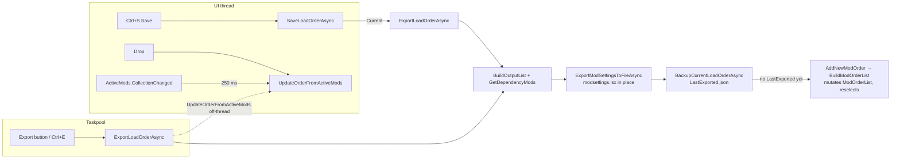

# VM2: MainWindowViewModel part 2 (orders, export to game, saves, deletion, filtering, drag/drop)

Reviewed against master `fc35358`, read-only. Nothing was built or run. MWVM = `src/GUI/ViewModels/MainWindowViewModel.cs`, DMDL = `src/Core/Util/DivinityModDataLoader.cs`, MVC = `src/GUI/Views/MainViewControl.xaml.cs`. Third-party behaviour was checked against source fetched at the exact versions in use: gong-wpf-dragdrop **4.0.0** `DropInfo.cs` (byte-identical to `scratchpad/dl-gong/DropInfo.cs`) and DynamicData **9.1.2** `ObservableCollectionExtended.cs` (copies in `scratchpad/vm2-gong/`). `origin/perf/list-render` does not touch any file in this scope (`git diff --stat`).

Already covered elsewhere and not repeated here: E1-E6, I1-I5, AUDIT-PLAN-01..13, HARV-20..35, HARV-52..58, HARV-61, 62, 65, 66, 69..77. Where a finding below extends one of them, `knownAs` names it.

## Map

### Files and responsibilities

| File | Role in this area |
|---|---|
| MWVM:1835-2070 | Import entry points: `AddModFromFile` (pak copy, archive and compressed dispatch), `ImportMods` (taskpool loop, result alert), `IsImportableFile`, `OpenModImportDialog`, `AddNewModOrder` (with the only undo snapshot in the app) |
| MWVM:2558-2712 | `GetOrdersDirectory`, `LoadExternalLoadOrdersAsync`, `SaveLoadOrder(Async)` (Current = export to game, otherwise order JSON), `SaveLoadOrderAs` |
| MWVM:2714-3035 | `DisplayMissingMods`, `ExportLoadOrder(Async)` (modsettings.lsx), `BackupCurrentLoadOrderAsync` (Orders/LastExported.json), `DeleteModCrashSanityCheck`, `OnMainProgressComplete` |
| MWVM:3041-3840 | Archive import/export and text export (audited by AUDIT-PLAN and HARV; only the parts others missed appear below) |
| MWVM:3842-4104 | `ImportOrderFromSave*`, `ImportOrderFromFile`, `RenameSave_Start` (dead: no UI binding), `CheckForUpdates` |
| MWVM:4105-4342 | `OnViewActivated`, filter parsing `OnFilterTextChanged`, `HiddenToLabel`/`SelectedToLabel`, `ShowAlert` |
| MWVM:4343-4690 | `DeleteOrder`, `DeleteMods`/`DeleteMod`/`RemoveDeletedMods`, `ExtractSelectedMods_*`, `ExtractSelectedAdventure`, `SortModOrder` (dead), rename toggling, `ClearMissingMods` |
| MWVM:4689-4889 | `LoadAppConfig`, `OnKeyDown/Up`, `AddActiveMod`/`RemoveActiveMod`, `UpdateOrderFromActiveMods` |
| MWVM:5400-5408 | `ActiveMods.CollectionChanged`: clears `HasExported`, debounces `UpdateOrderFromActiveMods` by 250 ms |
| MVC:161-213 | The b6cc68f order rename (`OrdersComboBox_LostFocus`): renames the JSON file |
| `ModListDropHandler.cs` | gong drop handler: file drops go to `ImportMods`, item drops remove from the source, insert at `UnfilteredInsertIndex`, renumber `Index`, reselect, re-filter, and call `UpdateOrderFromActiveMods` |
| `ModListDragHandler.cs` | Replaces gong's payload with `List.Where(IsSelected && Visible)` (lazy) |
| `DeleteFilesViewData.cs`, `ModFileDeletionData.cs`, `RecycleBinHelper.cs` | Delete dialog: VB `FileSystem.DeleteFile` to the recycle bin; in DEBUG builds nothing is deleted |
| `DivinityLoadOrder.cs` | `[DataContract]` with only `Order` as `[DataMember]`, so `Name`, `FilePath` and `IsModSettings` never round-trip through JSON |

### Main flows (call chains)

- **Save (Ctrl+S)**: `Keys.Save` (MWVM:4969) → `SaveLoadOrder` → `MainThreadScheduler.ScheduleAsync` (2594) → `SaveLoadOrderAsync` (2597). For Current it calls `ExportLoadOrderAsync` on the **UI thread**; otherwise `ExportLoadOrderToFileAsync` (DMDL:1098, `FileMode.Create` in place).
- **Export Order to Game (button, Ctrl+E)**: `ExportToModSettingsButton` (MVC:308) → `Keys.ExportOrderToGame` (MWVM:5163) → `ExportLoadOrder` → `TaskpoolScheduler.ScheduleAsync` (2843) → `ExportLoadOrderAsync` on a **pool thread**:
  `UpdateOrderFromActiveMods` (2901) → `DeleteModCrashSanityCheck` → `BuildOutputList` (DMDL:1431, recursive `GetDependencyMods`) → `ExportModSettingsToFileAsync` (DMDL:1331, `FileMode.Create` in place) → `BackupCurrentLoadOrderAsync` (2850) → [first time only] `AddNewModOrder` → `BuildModOrderList` → UI block via `Observable.Start` (2951).
- **Drag/drop**: gong → `ModListDragHandler.StartDrag` (lazy payload) → `ModListDropHandler.Drop` → remove from source, insert at `dropInfo.UnfilteredInsertIndex` (133) → O(n²) renumber (218-221) → `IsSelected` for all `Mods` → `OnFilterTextChanged(target)` → `UpdateOrderFromActiveMods`.
- **Order rebuild**: any `ActiveMods` Add/Remove/Reset/Move → 250 ms → `UpdateOrderFromActiveMods` (4880): `SelectedModOrder.Order.Clear(); AddRange(ActiveMods)`.
- **Delete mods**: `Keys.DeleteSelectedMods` (5044) → `DeleteMods` → `DeleteFilesViewData.Run` (pool thread via `Observable.StartAsync`) → `RecycleBinHelper.DeleteFile` → `FileDeletionComplete` (MVC:329) → `RemoveDeletedMods` (4378).

### Threading model

The VM has no `Dispatcher.Invoke`. Bound collections (`ActiveMods`, `InactiveMods`, `ModOrderList`) are plain `ObservableCollection`s with no `EnableCollectionSynchronization` (grep: none in src), so they must be mutated on the UI thread. Export to game, the zip export, imports, extraction and deletion run on the taskpool. Imports marshal `AddImportedMod` correctly with `Observable.Start(..., MainThreadScheduler)`. Export to game does not (VM2-03).

## Findings

### [High] VM2-01: Order entries for missing mods are silently stripped 250 ms after an order loads, so the next Save writes the order without them
- **Location:** MWVM:4880-4889 (`UpdateOrderFromActiveMods`), triggered by MWVM:5400-5408 from `LoadModOrder` MWVM:2141-2144. Contradicted by the code's own intent at MWVM:2688-2690 and 4670-4686.
- **What:** `LoadModOrder` puts only *loaded* mods into `ActiveMods`. The resulting Reset/Add events schedule `UpdateOrderFromActiveMods`, which does `SelectedModOrder.Order.Clear(); AddRange(ActiveMods, true)`. Every entry whose mod isn't installed is dropped from the in-memory order. `DisplayMissingMods` shows the warning (2149-2152) before the prune, so the user is told what is missing, and the entries then vanish. The rest of the code assumes they survive: `SaveLoadOrderAs` filters them out explicitly ("Save mods that aren't missing", 2688-2690), and `ClearMissingMods` removes them and says "Save to confirm" (4684). Both are no-ops after the prune.
- **Failure scenario:** a friend's 940-entry order, or one of your own saved orders while 5 paks are temporarily out of Mods (a re-download, testing a conflict, a failed update). Load it, drag one mod, press Ctrl+S. `Main.json` now has 935 entries, and the 5 positions are lost for good. The same happens to orders imported from saves (`GetLoadOrderFromSave`) and from text/TSV files, whose `Missing=true` entries are dropped before they can be resolved.
- **Evidence:** `SelectedModOrder.Order.Clear(); SelectedModOrder.AddRange(ActiveMods, true);` and `_updateOrderTask = RxApp.MainThreadScheduler.Schedule(TimeSpan.FromMilliseconds(250), UpdateOrderFromActiveMods);`. `ToOrderEntry()` copies only UUID and Name (LIB-final §1 F1 notes the same rebuild wipes pins).
- **Fix:** rebuild by merging. Walk the old `Order`; for each missing entry (UUID not in `mods`), remember its predecessor's UUID. Emit `ActiveMods` in order and re-insert each missing entry after its predecessor (or at its old index when it has none). Only `ClearMissingMods` removes them. Upstreamable `fix/order-keep-missing` from master. Test: load an order with 2 missing mods, drag, save, diff the JSON.
- **Confidence:** Confirmed (code path). The Windows run only needs to show the JSON diff.

### [High] VM2-02: The first Save of "Current" (no LastExported.json yet) switches the selection to another saved order and copies that order into Current and the profile
- **Location:** MWVM:2850-2869 (`BackupCurrentLoadOrderAsync` → `AddNewModOrder(backupOrder)`), MWVM:2063-2064 (`BuildModOrderList(ModOrderList.Count)`), MWVM:1794-1825 (LastExported moved to index 1), MWVM:2965-2975.
- **What:** When `Orders/LastExported.json` doesn't exist (first export ever, a new Orders folder, or after deleting the LastExported order), the backup goes through `AddNewModOrder`. Its `redo()` appends LastExported to `SavedModOrderList` and calls `BuildModOrderList(oldCount)`. But `BuildModOrderList` moves LastExported to index 1, so index `oldCount` is the **last saved order** (k≥1 saved orders), or LastExported itself (k=0). The method then selects that order and `LoadModOrder`s it, all inside the export. Back in `ExportLoadOrderAsync`, `SelectedModOrder` is no longer Current, so 2965-2968 run `Current.SetOrder(SelectedModOrder.Order)`, and 2970-2975 set `SelectedProfile.ActiveMods` to that order.
- **Failure scenario:** the user has a saved order "Main" (k=1), selects Current, arranges it, and presses Ctrl+S. modsettings.lsx gets the right order (A). The UI then jumps to "Main" and Current's in-memory order becomes Main's (B), and `Settings.LastOrder = "Main"`. The next time they select Current and Save or Export, B is written to the game and LastExported is overwritten with B. A survives nowhere. With k=0 (a fresh install) the UI lands on "LastExported", and every later Ctrl+S writes LastExported.json instead of exporting to the game.
- **Evidence:** `if (!updatedOrder) AddNewModOrder(backupOrder);`, `SavedModOrderList.Add(newOrder); BuildModOrderList(ModOrderList.Count);`, `var lastExported = savedOrders.FirstOrDefault(x => x.Name == "LastExported"); ... nextOrders.Add(lastExported);`, `this.ModOrderList.First(x => x.IsModSettings)?.SetOrder(SelectedModOrder.Order);`.
- **Fix:** never route the backup through `AddNewModOrder`/`BuildModOrderList`. On the UI thread, add the order to `SavedModOrderList` and insert it at `ModOrderList[1]` without touching `SelectedModOrderIndex`. Capture `var exported = SelectedModOrder` at the top of `ExportLoadOrderAsync` and use `exported` in 2937-2976. Skip the backup when the write failed (see VM2-04). `fix/lastexported-backup`.
- **Confidence:** Confirmed (pure C#/Rx trace on the UI thread). Windows test: delete Orders/LastExported.json, keep one saved order, select Current, Ctrl+S, and watch the dropdown.

### [High] VM2-03: "Export Order to Game" runs on the taskpool and mutates UI-bound state; the first export breaks the order list and stops with no alert
- **Location:** MWVM:2841-2848 (`ExportLoadOrder` → `TaskpoolScheduler.ScheduleAsync`), MWVM:2901, 2934, 2937; MWVM:1764, 1811-1812 (`BuildModOrderList`); MWVM:5191-5192 (`SelectedModOrder` OAPH); MVC:289 (ComboBox bound to `ModOrderList`). Extends CLAUDE.md §4 "Threading" and HARV-34 (which covers the zip export only).
- **What:** The Export button and Ctrl+E (MVC:308, MWVM:5163) run all of `ExportLoadOrderAsync` on a pool thread. This includes `UpdateOrderFromActiveMods`, which reads `ActiveMods` and rewrites `SelectedModOrder.Order` while the UI thread may run the same rebuild from the 250 ms timer (`List<T>` is not thread-safe). On the first export (the VM2-02 precondition), it also calls `BuildModOrderList`, which sets `IsLoadingOrder = true` and then `ModOrderList.Clear()`. `ObservableCollection.ClearItems` empties the list and raises `Count` first: the OAPH recomputes `SelectedModOrder = null` on the pool thread. It then raises Reset, which WPF's CollectionView rejects from a non-dispatcher thread (`NotSupportedException`). The catch at 2870 only logs. Then 2937 dereferences `SelectedModOrder.Order` → NullReferenceException, which escapes the `ScheduleAsync` lambda with no alert.
- **Failure scenario:** a new user (or the owner after a new Orders folder) clicks Export. modsettings.lsx is written, but there is no success alert, `SelectedProfile.ActiveMods` and `HasExported` aren't updated, `IsLoadingOrder` stays true (so `AllowDrop` is false and drag/drop is dead), the dropdown shows a stale list over an empty `ModOrderList`, and Save does nothing (`SelectedModOrder == null`). Only a restart recovers. The off-thread race alone (no first export) can, rarely, drop or duplicate entries in the exported order when Export follows a drag within 250 ms.
- **Evidence:** `RxApp.TaskpoolScheduler.ScheduleAsync(async (ctrl, t) => { await ExportLoadOrderAsync(); ...})`; `ModOrderList.Clear(); ModOrderList.Add(nextOrders);`; `if (SelectedModOrder.Order.Count > 0)`.
- **Fix:** take a snapshot on the UI thread (order entries, adventure mod, profile folder), run `BuildOutputList` and the write on the pool, and marshal every VM mutation (backup insertion, Current update, profile update, alerts) back with `Observable.Start(..., MainThreadScheduler)`. Simplest: make `ExportLoadOrder` call `SaveLoadOrder`-style `MainThreadScheduler.ScheduleAsync`, because the I/O is already async. Add a catch-all that `ShowAlert`s. `fix/export-ui-thread`.
- **Confidence:** Plausible. The off-thread mutations are certain from code. The exception and the UI state need a Windows run: fresh Orders folder, click Export, then try to drag and to switch orders.

### [High] VM2-04: Export to game overwrites modsettings.lsx in place with no backup or guard, so a failed mod load wipes every copy of the active order in one click
- **Location:** DMDL:1331-1364 (`ExportModSettingsToFileAsync`: `FileMode.Create`, one write); DMDL:1447-1465 (`BuildOutputList` drops unloaded UUIDs); MWVM:2934 (backup runs even when `result == false`); MWVM:2970-2975; MWVM:2289-2293 (restore needs `lastExported.Order.Count > 0`).
- **What:** (1) The game's file is truncated and rewritten in place. A crash, AV lock or full disk mid-write leaves an empty or partial modsettings.lsx, and the previous file is never backed up. (2) Nothing compares the new output with what the file held. Any mod that isn't loaded right now is silently left out, and after VM2-01 `DisplayMissingMods(SelectedModOrder)` at 2976 can't see it. (3) `BackupCurrentLoadOrderAsync` runs unconditionally, after the write, and backs up the *new* order, even an empty one or one from a failed export.
- **Failure scenario:** after a BG3 patch LSLib can't read the paks, or the Mods path is mis-detected, and the app loads 0 of 935 mods. Current loads empty (VM2-01 prunes the Missing entries). The user presses Ctrl+S or Export. modsettings.lsx gets only GustavX, LastExported.json becomes an empty order, `SelectedProfile.ActiveMods` empties, and the startup "restore" (2293) no longer offers anything. Partial version: 3 paks fail to parse, and Export silently removes them from the game's order.
- **Evidence:** `using var fs = new FileStream(outputFilePath, FileMode.Create, FileAccess.Write, FileShare.None, buffer.Length, true); await fs.WriteAsync(buffer);`; `await BackupCurrentLoadOrderAsync();` placed before `if (result)`.
- **Fix:** `fix/modsettings-safe-write`. Before writing, copy the current file to `modsettings.lsx.<yyyyMMdd-HHmmss>.bak` (keep the last 10). Write `modsettings.lsx.tmp` and `File.Replace`/`File.Move(tmp, final, true)`. Read it back with LSLib (S6-final INV-6). Parse the current file first. If the export would drop entries that are *present in the file but not loaded*, or would go from N>0 to 0 mods, show a confirm naming them. Back up LastExported only after success and never with an empty order; keep a short history (`LastExported.<n>.json`) and key it per profile (HARV-54).
- **Confidence:** Confirmed (code). The zero-mods trigger is an input condition, not a code uncertainty.

### [High] VM2-05: Export recurses without a cycle guard: a mod that lists itself, or two mods that depend on each other, crash the app with StackOverflow
- **Location:** DMDL:1400-1428 (`GetDependencyMods`), called from `BuildOutputList` DMDL:1438-1441, 1452-1455 when `AutoAddDependenciesWhenExporting` (default **true**, `DivinityModManagerSettings.cs:67-69`); dependencies are taken verbatim from meta.lsx (DMDL:251-276).
- **What:** `GetDependencyMods(dep)` recurses *before* `addedMods.Add(dep.UUID)`, and nothing tracks the recursion path. A self-dependency (A → A) or a cycle (A → B → A) recurses forever. StackOverflowException can't be caught in .NET, so the process dies instantly.
- **Failure scenario:** one of the owner's 1,121 mods has its own UUID in `<Dependencies>` (a copy-paste slip in meta.lsx), or two companion mods name each other. Every Save of Current and every Export kills the app before modsettings.lsx is written, with no message and no log (logging is off by default).
- **Evidence:** `var dependencyMods = GetDependencyMods(dependencyModData, allMods, addedMods); ... if (!addedMods.Contains(dependencyModData.UUID)) { mods.Add(dependencyModData); addedMods.Add(...) }`.
- **Fix:** add a `visiting` HashSet (skip a dependency already on the path or already in `addedMods`), and ignore `d.UUID == mod.UUID`. Use `Lookup` instead of `allMods.FirstOrDefault` (also O(n) per dependency). Optionally warn once about cyclic metadata. Small upstreamable `fix/dependency-cycle`.
- **Confidence:** Plausible. The infinite recursion is certain from code. Whether such metadata exists in the owner's set needs a one-off scan of the 1,097 meta.lsx dependency lists.

### [High] VM2-06: "Extract Selected Mods" lets a crafted pak write files anywhere (path traversal in LSLib UncompressPackage)
- **Location:** MWVM:4397-4479 and 4500-4575 → `DivinityFileUtils.ExtractPackageAsync` (`src/Core/Util/DivinityFileUtils.cs:284-309`) → `External/lslib/LSLib/LS/PackageCommon.cs:138-170` (`Path.Join(outputPath, file.Name)` at 162); `FileManager.TryToCreateDirectory` (`External/lslib/LSLib/LS/FileManager.cs:5-34`) only checks that the path is absolute.
- **What:** Entry names come straight from the pak's file table (`BinUtils.NullTerminatedBytesToString`, PackageFormat.cs:311 and siblings). `..\` segments are neither rejected nor confined: `Path.Join("C:\out\", "../../Users/x/AppData/Roaming/Microsoft/Windows/Start Menu/Programs/Startup/a.cmd")` then `File.Open(FileMode.Create)` writes outside the chosen folder, creating directories as needed.
- **Failure scenario:** a malicious or tampered Nexus pak. The user selects it and uses Tools → Extract Selected Mods. A script lands in the Startup folder and runs at the next logon. Nothing in the UI shows it.
- **Evidence:** `string outPath = Path.Join(outputPath, file.Name); FileManager.TryToCreateDirectory(outPath); using var outFile = File.Open(outPath, FileMode.Create, FileAccess.Write);`.
- **Fix:** in LSLib (upstream to LaughingLeader/lslib first, per BLD.md), compute `full = Path.GetFullPath(Path.Join(root, name))` and reject any entry that doesn't start with `Path.GetFullPath(root)` plus a separator, or whose name is rooted. Until the submodule moves, pass a `filter` from `ExtractPackageAsync` that drops such entries and alerts.
- **Confidence:** Confirmed (code). Exploitation needs a hand-made pak; LSLib's own writer would happily store such a name.

### [Medium] VM2-07: Order rename (b6cc68f) fails on unsaved orders, deletes the selected order from the list when the name is unchanged, and resurrects the overwritten one
- **Location:** MVC:161-213; `StopRenaming`/`ToggleRenamingLoadOrder` MWVM:4609-4668; `canRenameOrder` MWVM:5326.
- **What:**
  - (a) `File.Move(lastFilePath, nextFilePath, true)` assumes the file exists. A new order from Add New Order has a `FilePath` but no file until saved, so renaming it throws FileNotFoundException. An imported order with `FilePath == null` (HARV-32, VM2-09) throws ArgumentNullException from `Path.Combine`. Either way the user gets an error box with a stack trace, and the order isn't renamed.
  - (b) Rename, then click away without editing: the text is the same name, `File.Exists(next)` is true, and the user is asked "Overwrite '…\Main.json'?". On Yes, `existingOrder = ModOrderList.FirstOrDefault(x => x.FilePath == nextFilePath)` is **the order being renamed**, and it is removed from `ModOrderList`, so the selection drops to nothing.
  - (c) When a different order really is overwritten, it is removed only from `ModOrderList`, not `SavedModOrderList`. The next `BuildModOrderList` brings it back with the same `FilePath` as the renamed order, and saving either one overwrites the other.
  - (d) Path compares are ordinal, so "Main" → "main" on NTFS hits the overwrite prompt for the same file.
- **Failure scenario:** Add New Order, then immediately Rename to "Coop" → error dialog. Or Rename → change your mind → click elsewhere → Yes → the order disappears from the dropdown until restart.
- **Fix:** if `nextName == order.Name` (OrdinalIgnoreCase), just stop. If the file doesn't exist, rename in memory and set the new `FilePath`. Compare paths with `Path.GetFullPath` + OrdinalIgnoreCase. Remove an overwritten order from both lists and never remove `order` itself. Validate the name (empty, reserved names per HARV-35).
- **Confidence:** Confirmed for (a), (c), (d) and the self-removal in (b) (code). The visible selection state in (b) needs Windows.

### [Medium] VM2-08: Delete Order removes the order only from the visible list; it comes back on the next rebuild, and recycle-bin failure is reported as success
- **Location:** MWVM:4343-4357; `SavedModOrderList` MWVM:220; rebuilds at MWVM:2064 (`AddNewModOrder`), 5230 (profile change), 2850-2868 (first backup).
- **What:** `ModOrderList.Remove(order)` leaves `order` in `SavedModOrderList`. `BuildModOrderList` rebuilds from `SavedModOrderList`, so Add New Order, a profile switch or an archive import brings the deleted order back. Its file is in the recycle bin, and the next Save recreates it. `RecycleBinHelper.DeleteFile` returns false on failure (locked file, cloud placeholder), but the alert says "Sent load order … to the recycle bin" either way. The confirm text says "This cannot be undone", which is wrong for a recycle.
- **Failure scenario:** delete the "Old" order, then click Add New Order → "Old" is back in the dropdown. Select it by mistake and press Ctrl+S → Old.json is back on disk. Deleting LastExported this way also produces duplicate LastExported entries after the next export (VM2-02).
- **Fix:** remove it from `SavedModOrderList` too. Check the return value and alert on failure. Fix the dialog text. Optionally push an undo snapshot (VM2-22).
- **Confidence:** Confirmed.

### [Medium] VM2-09: "Import Order from File" (.json) creates a nameless, pathless order; every such order saves to `Orders/.json` and overwrites the previous one
- **Location:** MWVM:3923-3977; DMDL:1209-1218 (`return savedOrder;` skips the naming at 1322-1326); `DivinityLoadOrder.cs:23-44` (`[DataContract]`, only `Order` is a `[DataMember]`); `SaveLoadOrderAsync` MWVM:2613-2620. Extends HARV-32.
- **What:** Newtonsoft honours `[DataContract]` opt-in, so a saved order JSON deserializes with `Name == null` and `FilePath == null`. The non-deciphered branch adds it with `AddNewModOrder(newOrder)` and alerts "Successfully imported order ''". On Save, `MakeSafeFilename(null + ".json")` is ".json", so the file is `<LoadOrderPath>/.json`. After a restart it loads as an order named "" (`GetFileNameWithoutExtension(".json")`).
- **Failure scenario:** the owner imports two friends' order files and saves each. The second one silently replaces the first in `Orders/.json`. Rename fails (VM2-07a). `GetLoadOrderFromSave` has the related collision: importing the same save twice yields two orders with the same name and path (`<profile>_<save>.json`), and saving one overwrites the other without a prompt.
- **Fix:** in `LoadOrderFromFile`, set `Name = Path.GetFileNameWithoutExtension(file)` for every branch. In `AddNewModOrder`, give imported orders a unique name and `FilePath` in the Orders folder (`Name (2)`), and prompt before saving over an existing file. Ships with the S8 import fixes.
- **Confidence:** Confirmed (code; the Newtonsoft DataContract opt-in rule).

### [Medium] VM2-10: New orders are named "New{count}", which collides with a surviving order after a deletion, and Save overwrites it
- **Location:** MWVM:2052-2061.
- **What:** `Name = $"New{nextOrders.Count}"`, where `nextOrders` is `SavedModOrderList` (LastExported included), and `FilePath = Orders/<Name>.json` with no existence check. Delete an order and restart (or, with VM2-08, without restarting the count stays the same), and the next number can equal a name that still exists.
- **Failure scenario:** saved orders are LastExported, New1 and New2. Delete New1 and restart (saved = 2) → Add New Order creates "New2" pointing at the existing `New2.json`. Ctrl+S on it silently overwrites the real New2.
- **Fix:** choose the smallest `NewN` whose name and file are both unused (`File.Exists` plus a name check, OrdinalIgnoreCase).
- **Confidence:** Confirmed.

### [Medium] VM2-11: Every order load or switch raises one CollectionChanged per mod (about 1,120 events for the owner) through the lists and the 250 ms debounce
- **Location:** MWVM:2141-2144 (`ActiveMods.Clear(); ActiveMods.AddRange(...)`, same for Inactive); DynamicData 9.1.2 `ObservableCollectionExtended.AddRange` = `foreach Add(item)` (ObservableCollectionExtended.cs:52-60); handler MWVM:5400-5408; `RemoveDeletedMods` MWVM:4391-4393 (`RemoveMany`).
- **What:** Each Add raises `Count`/`Item[]` PropertyChanged and an Add CollectionChanged. Each event runs the VM handler (creates and disposes a DispatcherTimer via `MainThreadScheduler.Schedule(250 ms)`), `WhenAnyValue(x => x.ActiveMods.Count)` (5010), the ListView's CollectionView (binary insertion when a header sort is active), the ItemContainerGenerator/VirtualizingStackPanel item-change path, and UIA events when a client is attached. At 935 + 186 rows that is about 1,120 events per order switch, profile switch, refresh-end and `ImportOrderFrom*`.
- **Failure scenario:** order switches feel slow. This is a plausible contributor to the "first filter of the session" and order-switch latency, and to UIA-tree churn during the owner's driver measurements.
- **Fix:** `using (ActiveMods.SuspendNotifications()) { ActiveMods.Clear(); ActiveMods.AddRange(...); }`, which raises exactly one Reset (ObservableCollectionExtended.cs:132-144). Do the same for InactiveMods and `RemoveDeletedMods`. The VM handler then schedules one rebuild. Safe for gong and the drop handler (they read the collections, not the events). `perf/order-load-reset` from master.
- **Confidence:** Plausible. The event count is certain from source; the wall-clock cost needs a Stopwatch around `LoadModOrder` plus a ContextIdle callback, on Windows, in Debug and Release.

### [Low] VM2-12: The 250 ms rebuild writes into whichever order is selected when the timer fires, not the one that changed
- **Location:** MWVM:4880-4889, 5400-5408; order switch MWVM:5197-5221 (`ObserveOn` to the dispatcher, then `OrderEquals` short-circuit).
- **What:** `UpdateOrderFromActiveMods` reads `SelectedModOrder` at fire time. If the user switches order (combobox, keyboard) inside the 250 ms window after an Alt+Up/drag, there is a window between `SelectedModOrderIndex` changing (the OAPH updates synchronously) and the posted `LoadModOrder`. If the timer tick runs in that window, it writes the *old* list into the *new* order. The `OrderEquals` check then sees them equal and skips loading, so the new order keeps the old content. Separately, the pool-thread call in VM2-03 races the timer.
- **Failure scenario:** rare: Alt+Up, then immediately pick another order. Order B silently takes A's list in memory, and Ctrl+S persists it.
- **Fix:** capture the target at schedule time: `var target = SelectedModOrder; Schedule(250ms, () => Rebuild(target))`, and flush any pending rebuild synchronously before an order switch or export.
- **Confidence:** Plausible (depends on dispatcher ordering of a DispatcherTimer tick against a posted Normal-priority item; needs a Windows repro with a scripted switch).

### [Low] VM2-13: modsettings.lsx escapes Name but not Folder, so one '&', '<' or '"' in a Folder makes every export fail as "Is the file locked?"
- **Location:** DMDL:1478-1482; template `src/Core/DivinityApp.cs:33`; message MWVM:2988.
- **What:** `SecurityElement.Escape` is applied to `Name` only. `Folder` (decoded from meta.lsx by XDocument), `MD5` and `UUID` are formatted raw. `xml.LoadXml(contents)` then throws, the generic catch logs it, and the method returns false. The file is left untouched, which is safe, but the user is told the file may be locked.
- **Fix:** escape every interpolated value (or build the XML with `XElement`). Show the real exception message in the failure alert.
- **Confidence:** Confirmed (code). Whether any of the owner's Folders contain these characters is unknown.

### [Low] VM2-14: Several failures in this area give the user no feedback or the wrong feedback (logging is off by default)
- **Location:** Save As MWVM:2691 → DMDL:1080-1096 (sync `FileStream`, no try/catch) → Hotkey command (`src/Core/Models/App/Hotkey.cs:124`) → `MainWindowExceptionHandler.OnNext` logs only; `SaveLoadOrderAsync` MWVM:2611 (`CreateDirectory` outside the try); pak import MWVM:1845 with `CopyFileAsync` swallowing every exception (`DivinityFileUtils.cs:359-373`) so the "locked" alert at 1862 is unreachable for copy errors and `result.Errors` stays empty while the alert says "Check the log"; deletion completion MVC:329-340 shows no alert, and per-file failures in `DeleteFilesViewData.cs:95-98` only log; `RenameSave_Start` MWVM:4072-4080. Same class as HARV-06 and plan R8.
- **Failure scenario:** Save As into a read-only folder does nothing visible. A pak import onto a locked file says "Only imported 0/1 mods - Check the log" with no log. Deleting 10 mods where 2 are locked closes the dialog silently, and the 2 stay in the list.
- **Fix:** catch around these calls and `ShowAlert` with the file name and `ex.Message`. Record pak copy errors with `taskResult.AddError`. After deletion, show "Deleted N of M; failed: …".
- **Confidence:** Confirmed.

### [Low] VM2-15: Extract: the "single pak into a same-named folder" check is dead, and Cancel doesn't stop extraction
- **Location:** MWVM:4439 and 4543 (`Path.GetDirectoryName(outputDirectory).Equals(pakName)`); `DivinityFileUtils.cs:284-309`.
- **What:** `GetDirectoryName` returns the parent path, which never equals the bare pak name; `Path.GetFileName` was meant. `ExtractPackageAsync` uses the E4 pattern: a `Task.Delay(0, token)` busy-spin pins a core, and on cancel it throws while the `StartNew` child keeps writing files. The VM catch logs, then reports "Error occurred…" while extraction continues in the background.
- **Fix:** use `Path.GetFileName(outputDirectory)` (OrdinalIgnoreCase). Run `UncompressPackage` directly on the pool, with a filter callback that checks the token.
- **Confidence:** Confirmed.

### [Low] VM2-16: Dropping .pak files from Explorer onto the active list ignores the drop position
- **Location:** `ModListDropHandler.cs:118-129` → MWVM:1880 → 1853 → `AddImportedMod` 3214-3219 → `AddActiveMod` 4841-4851.
- **What:** The file branch returns before `UnfilteredInsertIndex` is read. New mods are always appended at the bottom of the load order, wherever the user dropped them.
- **Fix:** pass `dropInfo.UnfilteredInsertIndex` (or the item-based resolver from S5-final Step 4) through `ImportMods` and insert there.
- **Confidence:** Confirmed.

### [Low] VM2-17: The "N Matched, M Hidden" label goes stale when the list changes but the hidden count doesn't
- **Location:** MWVM:5269-5271, 4178-4188.
- **What:** `HiddenToLabel(x, ActiveMods.Count)` is re-evaluated only when `TotalActiveModsHidden` changes, so `ActiveMods.Count` is captured then. A drop of a matching mod, a delete or an import changes the count without changing the hidden total.
- **Fix:** `WhenAnyValue(x => x.TotalActiveModsHidden, x => x.ActiveMods.Count)`.
- **Confidence:** Confirmed.

### [Low] VM2-18: The Script Extender warning lists every dependency of an SE mod as needing SE
- **Location:** MWVM:2797-2810 (test at 2804).
- **What:** Inside the dependency loop the code tests `mod.ExtenderIcon` again (always true there) instead of `dependencyMod.ExtenderIcon`.
- **Fix:** test `dependencyMod`.
- **Confidence:** Confirmed.

### [Low] VM2-19: `DivinitySaveTools.RenameSave` writes an empty package (latent: no UI invokes it)
- **Location:** `src/Core/Util/DivinitySaveTools.cs:9-134` (`new PackageBuildData{...}` at 113 with no `Files`, written at 120); MWVM:3979-4083 (recycles the original at 4063 when the folder name matches); `RenameSaveCommand` MWVM:5129 has no XAML binding or hotkey (grep).
- **What:** The save is read, but none of its files are added to `build.Files`, so `PackageWriter` writes a header-only LSPK, sets its timestamps, returns true, and the VM alerts "Successfully renamed". In a DOS2-style layout (folder name == save name) the original is then sent to the recycle bin.
- **Fix:** don't wire this command up. If it's ever revived, copy each `PackagedFileInfo` into `build.Files` and verify by re-reading, or simply copy the file and rename the screenshot. Otherwise delete it.
- **Confidence:** Confirmed (dead today).

### [Low] VM2-20: `DeleteModCrashSanityCheck` uses a non-recursive delete, so a non-empty folder survives silently
- **Location:** MWVM:2876-2895 (2885).
- **What:** `Directory.Delete(path)` throws IOException if the folder holds anything, and the catch only logs. The setting then silently does nothing.
- **Fix:** `Directory.Delete(path, true)`, and alert on failure.
- **Confidence:** Plausible (depends on what BG3 puts in that folder; check on Windows after a crash).

### [Low] VM2-21: `OnViewActivated` saves settings straight after a failed load, overwriting a corrupt settings.json with defaults
- **Location:** MWVM:4126-4128; `LoadSettings` MWVM:1114-1135 (VM1 area); `SaveSettings` writes with `File.WriteAllText` (MWVM:1256).
- **What:** If settings.json is partial (a crash during the non-atomic write) and `SafeDeserialize` returns null, `loaded == false`, defaults are used, and `SaveSettings()` immediately replaces the file. The game path, Orders path and keybindings are lost with no backup. If `LoadOrderPath` was custom, the saved orders "disappear".
- **Fix:** when `!loaded && File.Exists(settingsFile)`, rename it to `settings.json.corrupt-<ts>` and alert before saving defaults. Write settings with temp+rename.
- **Confidence:** Plausible (needs a corrupt file; the overwrite itself is certain).

### [Info] VM2-22: There is no usable undo for order edits
- **Location:** `src/Core/ViewModels/BaseHistoryViewModel.cs:56-59, 85-100`; MWVM:2067 (the only `CreateSnapshot`); grep finds no binding for `UndoCommand`/`RedoCommand` anywhere in GUI.
- **What:** The ReactiveHistory stack exists and records only "Add New Order". Drags, deletes, clears, imports-over-current (`ImportOrderFromSaveToCurrent` 3898-3921, `ImportOrderFromFile` 3946-3957 overwrite the selected order without a confirm) and renames can't be undone.
- **Fix (fork or upstream):** snapshot `Order` entry lists (cheap: 935 small records) on drop, move, clear-missing, import-into-current and delete, and bind Ctrl+Z/Ctrl+Y through AppKeys `[MenuSettings("Edit", …)]`. This pairs naturally with VM2-01's merge rebuild.
- **Confidence:** Confirmed.

### [Info] VM2-23: In Debug builds "Delete" deletes nothing but reports success and removes the mods from the list and order
- **Location:** `DeleteFilesViewData.cs:84-92` (`#if DEBUG eventArgs.DeletedFiles.Add(f);`).
- **What:** Intentional developer safety, but the owner runs Debug builds for baselines. A delete looks complete, the mods leave the lists and `SelectedModOrder`, and they return on refresh.
- **Fix:** in DEBUG, show "DEBUG: files not deleted" in the confirm dialog and the alert, or gate it on a setting.
- **Confidence:** Confirmed.

### [Info] VM2-24: Document claim checks in this area
- **knownAs:** S5-final §4.3/Step 4; HARV-71; HARV-58; HARV-57.
- **S5-final's three filtered-drop cases hold**, checked against gong **4.0.0** `DropInfo.cs` (fetched; identical to `dl-gong`). With no container under the cursor, `itemParent` stays null (the else-branch at :372 sets `InsertIndex = itemsControl.Items.Count`), so `UnfilteredInsertIndex` returns the view count raw (:60-63): k for "below the last visible row", 0 (top of the load order) for "nothing matches". For "lower half of row A", `InsertIndex = view(A)+1` is remapped to `IndexOf(Items[view(A)+1])` = source(B) (:66-73), which skips hidden mods between A and B. All three apply **only after** a move to collection filtering. S5-final says so itself, and today `Items.Count == ItemsSource.Count`, so the raw index is the source index.
- **One behaviour change S5-final doesn't list:** today, under visibility stamping, a drop into the empty area below the last visible row lands at `Items.Count` = the **very end of the load order** (after hidden mods). S5-final's resolver "after the last visible item" changes that. Put it in T-D1…T-D7 explicitly.
- **HARV-71 (sorted active list drops at the view index) is confirmed:** header sort applies to the active list (`HorizontalModLayout.xaml:115`, `.xaml.cs:752-776`), and counts are equal, so no remap happens.
- **HARV-58 correction:** the `SortModOrder` half is moot. Its only caller is the dead `WhenAnyPropertyChanged(nameof(Index))` subscription (MWVM:5256-5259, HARV-57), so it costs nothing at runtime. Delete both rather than optimise.

## Opportunities aligned with the owner's intentions

All of these are small and cut from clean master (upstreamable unless noted). Ranked by value per line changed:

1. **`fix/lastexported-backup` + `fix/export-ui-thread` (VM2-02, VM2-03).** About 30 lines: snapshot on the UI thread, insert LastExported at index 1 without reselecting, capture `exported = SelectedModOrder`. This removes the worst first-run experience every friend of the owner will hit.
2. **`fix/modsettings-safe-write` (VM2-04).** Rotating `.bak` files, temp+replace, read-back, and an "about to drop N mods that are not loaded" confirm. It matches the plan's R8 ("every failure surfaces") and protects the 935-mod order. It also gives the LIB-final hardlink deploy a safe write primitive to reuse.
3. **`fix/order-keep-missing` (VM2-01).** A merge-based `UpdateOrderFromActiveMods`. It is also the natural place for S6 dividers and LIB pins to survive the rebuild (S6-final §5, LIB-final §1 F1 already route around this function). Doing it first makes both simpler.
4. **`fix/dependency-cycle` (VM2-05).** A ten-line guard that eliminates a hard crash. Run a one-off scan of the owner's paks for self/cyclic deps to size it.
5. **LSLib traversal guard (VM2-06).** Upstream to LaughingLeader/lslib, then bump the submodule. In the meantime, add the `filter` callback in `ExtractPackageAsync`.
6. **`perf/order-load-reset` (VM2-11).** Wrap the Clear+AddRange pairs in `SuspendNotifications()`. It's free and measurable with the owner's existing driver (order switch time and UIA event count).
7. **Order-management hygiene `fix/order-files` (VM2-07, VM2-08, VM2-09, VM2-10).** One branch: unique naming, `SavedModOrderList` kept in sync, rename without a file, `Name` on import. It pairs with HARV-32/35 and S8 §2.2.
8. **Small perf:** `BuildOutputList`/`GetDependencyMods` and `SaveLoadOrderAs` use `FirstOrDefault`/`Any` scans (about 0.5-1 M string compares at 935 × 1,121); switch to `mods.Lookup` and a `HashSet`. The `selectedPakMods` filter (MWVM:5332) calls `File.Exists` synchronously on the UI thread for every `IsSelected` change (Ctrl+A on Active = 935 syscalls); cache `File.Exists` per refresh or use `!IsEditorMod && !string.IsNullOrEmpty(FilePath)` and check existence only when extracting.
9. **Undo (VM2-22), fork-first.** Snapshot `Order` lists on structural edits. It would make the owner's large-order editing much safer and can go upstream once proven.

Out of scope but noticed (VM1 range): `CheckForEmptyOrderAsync` restores LastExported into `SavedModOrderList.FirstOrDefault()` (MWVM:2291, 2313). That is the first saved order loaded from disk, not Current, so the user's first saved order is overwritten in memory with LastExported.

## Needs a Windows run to settle

1. **VM2-03:** fresh Orders folder (no LastExported.json), click Export: is there a NotSupportedException or NRE in the log (enable logging), no alert, a stale dropdown, and dead drag/drop?
2. **VM2-02:** delete LastExported.json, keep one saved order, select Current, Ctrl+S: does the dropdown jump to the saved order, and does Current now show that order?
3. **VM2-01:** load an order with two uninstalled mods, drag once, Ctrl+S, and diff the JSON.
4. **VM2-05:** scan the owner's meta.lsx dependency lists for self or cyclic references (it can be scripted without the GUI from the paks). Then export with such a pair to confirm the crash.
5. **VM2-11:** Stopwatch around `LoadModOrder` plus a ContextIdle callback for an order switch at 935/186 rows, with and without `SuspendNotifications`, with no UIA client attached.
6. **VM2-07 (b):** Rename → click away → Yes: does the selection go to -1 and does Save stop working?
7. **VM2-12:** Alt+Up then an immediate order switch (scripted with 200-260 ms gaps): does order B take A's list?
8. **VM2-20:** what BG3 leaves in `ModCrashSanityCheck` after a mod crash, and whether the non-recursive delete fails.
9. **VM2-04:** confirm the game's behaviour on a truncated modsettings.lsx (reset vs refuse), and whether BG3 rewrites modsettings.lsx on exit while the manager exports during play (there is no game-running check on export).
10. **Deletion from a pool thread:** VB `FileSystem.DeleteFile(..., UIOption.OnlyErrorDialogs, SendToRecycleBin)` is called from the taskpool (`DeleteFilesViewData.Run` via `Observable.StartAsync`). Check that error dialogs appear and are parented, and that recycling works from an MTA thread.
